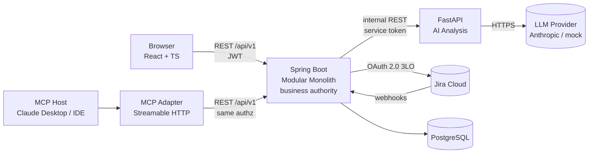

# Iris — SmartWork AI Platform

AI-powered enterprise work orchestration platform that works together with Jira Cloud.

SmartWork AI ingests work from two directions — **ticket-originated operational work** and **planned project / software development work** — analyzes it with an LLM (Gemini 1.5/2.0 Flash / Anthropic), decomposes it into actionable items, ranks candidate assignees deterministically, routes the decision through a policy engine, and synchronizes approved outcomes with Jira.

> **Status: Phase 10 in progress.**
> Phase 1 delivered the design ([docs/](docs/)); Phase 2 the backend foundation; Phase 3
> the Work Item domain, typed links with cycle detection, and the workflow engine with its
> ten guards. Phase 4 added the FastAPI AI service with a deterministic mock provider so
> the demo never depends on a live LLM ([ai-service/README.md](ai-service/README.md)).
> Phase 5 connects them: process templates with deterministic matching and instantiation,
> the AI client with graceful degradation, and the seven-component assignment scorer with
> hours-based workload — see [backend/README.md](backend/README.md).
> Phase 6 adds the policy engine: six routes evaluated strictest-first, the fourteen
> auto-assign conditions, approval queues and escalation.
> An onboarding ticket now produces a nine-task cross-department plan, most of which
> assigns itself — and the one task that commits budget stops for a human.
> Phase 7 adds the React and TypeScript frontend: one role-aware application shell, the
> employee dashboard, unified My Work, ticket and work-item creation, the adaptive work
> item detail, the team lead review queue with the backend's own candidate ranking, and
> process owner, manager and administration screens — see [frontend/README.md](frontend/README.md).
> Phase 9 adds the optional MCP adapter on Streamable HTTP, plus frontend and adapter
> CI workflows. Reporting remains partial: some manager analytics still use explicit demo
> fixtures where no backend endpoint exists yet.
> Phase 10 hardens the presenter path: seeded scenarios, a repeatable demo smoke script,
> and a live runbook for the three safest flows.

---

## Phase 1 documentation index

| # | Document | What it answers |
|---|---|---|
| 00 | [Overview & assumptions](docs/00-overview.md) | What the product is, what we assumed, what we deliberately excluded |
| 01 | [Architecture](docs/01-architecture.md) | Services, boundaries, module map, runtime topology, tech decisions |
| 02 | [Domain model](docs/02-domain-model.md) | Work Item hierarchy, families, origins, typed links, invariants, progress |
| 03 | [Roles & authorization](docs/03-roles-and-authorization.md) | System roles vs resource-scoped relationships, permission matrix |
| 04 | [Workflows](docs/04-workflows.md) | Six workflow profiles, ticket flow, dev flow, ticket→bug conversion |
| 05 | [Database & ER diagram](docs/05-database-er.md) | All tables, keys, indexes, constraints, Flyway migration plan |
| 06 | [REST API contract](docs/06-api-contract.md) | Endpoints, DTOs, error model, pagination, filtering |
| 07 | [AI service contract](docs/07-ai-service-contract.md) | FastAPI schemas, provider abstraction, validation & repair strategy |
| 08 | [Policy engine & assignment](docs/08-policy-and-assignment.md) | Routing decisions, candidate scoring, workload math, level policies |
| 09 | [Jira integration](docs/09-jira-integration.md) | OAuth 3LO, mappings, sync strategies, outbox, staleness |
| 10 | [MCP server](docs/10-mcp-server.md) | Resources, tools, prompts, authorization pass-through |
| 11 | [Security](docs/11-security.md) | AuthN/AuthZ, tenancy isolation, secrets, prompt injection, audit |
| 12 | [Folder structure](docs/12-folder-structure.md) | Repo layout for all four services |
| 13 | [Decision log (ADRs)](docs/13-decisions.md) | Every non-obvious choice, with rejected alternatives |
| 14 | [Scope & roadmap](docs/14-scope-and-roadmap.md) | MVP vs post-MVP, phase plan, demo scenarios |

## System at a glance



**Four processes. One database. One business authority.**
Spring Boot owns all state, policy and authorization. FastAPI is a stateless analysis function. The MCP adapter is a protocol translator with zero privileges of its own. The frontend never touches Jira or the LLM.

## Technology

| Layer | Choice |
|---|---|
| Frontend | React 18, TypeScript 5 (strict), Vite 6, React Router 6, TanStack Query 5, React Hook Form + Zod, Tailwind CSS 3, Lucide icons, Vitest + Testing Library + MSW |
| Backend | Java 21, Spring Boot 3.3, Spring Security, Spring Data JPA, Spring Modulith, Flyway, springdoc-openapi |
| Database | PostgreSQL 16 |
| AI service | Python 3.12, FastAPI, Pydantic v2, pluggable LLM provider (Anthropic + Mock) |
| MCP | Official Python MCP SDK, Streamable HTTP transport |
| Infra | Docker, Docker Compose, GitHub Actions |

## Running

```bash
cp .env.example .env
docker compose up --build
```

Available now:

- Backend + OpenAPI: http://localhost:8080/swagger-ui.html
- Backend health: http://localhost:8080/actuator/health
- AI service + OpenAPI: http://localhost:8000/docs
- AI service health: http://localhost:8000/health, readiness (incl. active provider): http://localhost:8000/ready

- Frontend: http://localhost:5173

Optional in Phase 9:

- MCP adapter health: http://localhost:9000/health
- MCP adapter endpoint: http://localhost:9000/mcp

Start it with:

```bash
docker compose --profile mcp up --build
```

Both external dependencies will degrade gracefully: with no `ANTHROPIC_API_KEY` the AI service runs the deterministic mock provider; with no Jira connection the platform runs fully and queues outbox events without draining them.

## Demo smoke

With the stack already running:

```bash
make demo
```

This runs [scripts/demo_smoke.sh](scripts/demo_smoke.sh) and exercises three seeded demo paths through the real APIs:

- employee onboarding with incomplete input
- development work with richer scope
- production-sensitive payments incident

The presenter runbook lives in [docs/15-demo-runbook.md](docs/15-demo-runbook.md).

## License

Hackathon MVP. Not licensed for production use.
