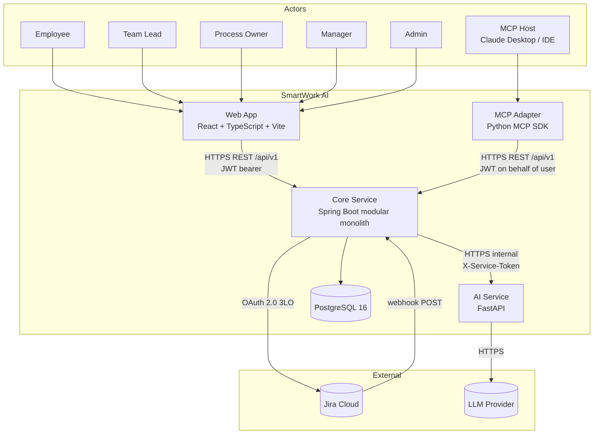
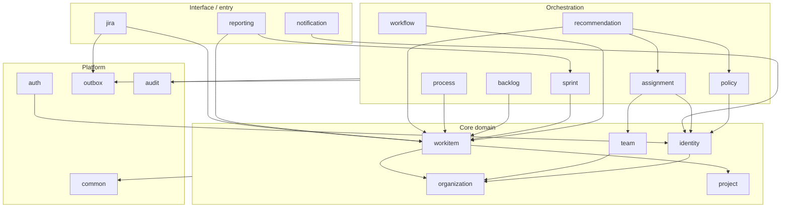
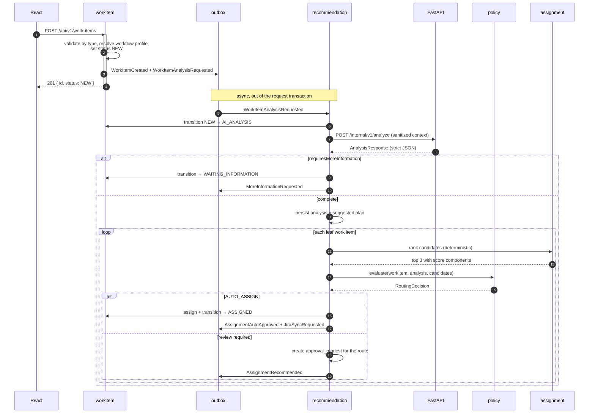
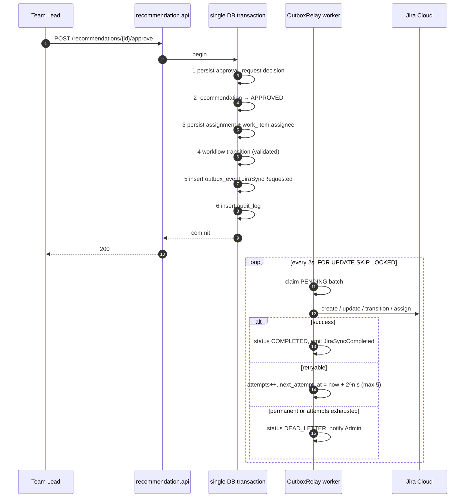

# 01 — Architecture

## 1. System context



### Boundary rules (non-negotiable)

| Rule | Enforced by |
|---|---|
| Frontend talks only to Spring Boot | CORS allowlist + no Jira/LLM credentials ever reach the browser |
| Frontend never receives a Jira token | Jira tokens are encrypted at rest and never appear in any DTO; a serialization test asserts this |
| FastAPI holds no Jira credentials and no database connection | The AI service container has neither `DATABASE_URL` nor `JIRA_*` in its environment |
| FastAPI cannot change workflow state | It has no write path — the only outbound call it can make is to the LLM provider |
| FastAPI cannot make authorization decisions | Its response schema has no field that a controller reads for an authz decision |
| MCP never touches PostgreSQL | The MCP container has no `DATABASE_URL`; its only dependency is the backend base URL |
| MCP cannot bypass policy | Every MCP tool is a thin call to an existing `/api/v1` endpoint with the caller's own JWT |
| Controllers never expose JPA entities | ArchUnit rule: no class in `..api..` may reference a type annotated `@Entity` |

## 2. Why a modular monolith

The domain is heavily transactional and heavily cross-referential. A single approval touches `recommendations`, `assignments`, `work_items`, `approval_requests`, `outbox_events` and `audit_logs` — and must be atomic. Splitting the Java side into microservices would replace one database transaction with a distributed saga for the single most important operation in the product.

We split only where the *runtime* genuinely differs:

| Process | Split because |
|---|---|
| **Spring Boot core** | The transactional business authority. Everything stateful lives here. |
| **FastAPI AI service** | Different language ecosystem (Pydantic, LLM SDKs), different scaling profile (slow, IO-bound, bursty), different failure mode (must be allowed to fail without taking down the platform). Stateless. |
| **MCP adapter** | Different protocol (MCP Streamable HTTP), different consumer (agents, not browsers), and must be independently deployable/removable. Stateless. |
| **React frontend** | Static asset bundle. |

Module boundaries inside the monolith are enforced at build time by Spring Modulith's `ApplicationModules.verify()`, so the option to extract a module later stays open without any of the cost now.

## 3. Spring Boot module map



### Module responsibilities

| # | Module | Owns | Key types |
|---|---|---|---|
| 1 | `auth` | Login, JWT issue/verify, refresh token rotation, logout, password hashing | `AuthController`, `JwtService`, `RefreshTokenStore` |
| 2 | `identity` | Users, system roles, user↔skill proficiency, employee level, capacity | `User`, `Role`, `UserSkill`, `EmployeeLevel` |
| 3 | `organization` | Organization, departments, tenancy context | `Organization`, `Department`, `OrganizationContext` |
| 4 | `project` | Projects, components, Jira project linkage | `Project`, `ProjectComponent` |
| 5 | `team` | Teams, memberships, team capacity | `Team`, `TeamMember` |
| 6 | `workitem` | The Work Item aggregate, typed links, comments, attachments, skills, progress | `WorkItem`, `WorkItemLink`, `ProgressCalculator` |
| 7 | `workflow` | Workflow definitions, states, transitions, guard evaluation | `WorkflowDefinition`, `TransitionValidator`, `WorkflowEngine` |
| 8 | `process` | Process templates, template instantiation, process instances | `ProcessTemplate`, `ProcessInstantiator` |
| 9 | `backlog` | Backlog ordering, ready-state rules | `BacklogEntry`, `BacklogService` |
| 10 | `sprint` | Sprints, sprint membership, capacity, snapshots | `Sprint`, `SprintCapacityCalculator` |
| 11 | `recommendation` | AI client, analysis persistence, plan generation, staleness, candidate storage | `AiAnalysisClient`, `Recommendation`, `StalenessDetector` |
| 12 | `assignment` | Candidate discovery, deterministic scoring, workload, assignment records | `CandidateScorer`, `WorkloadCalculator`, `Assignment` |
| 13 | `policy` | Assignment policies, employee level policies, routing decision | `PolicyEngine`, `RoutingDecision`, `LevelRestrictionEvaluator` |
| 14 | `jira` | OAuth 3LO, token store, Jira REST client, mappings, webhooks, sync jobs | `JiraOAuthService`, `JiraClient`, `JiraMappingResolver`, `JiraWebhookController` |
| 15 | `reporting` | Ticket/dev/capacity/AI metrics, dashboards | `ReportingQueryService` |
| 16 | `notification` | In-app notifications, read state | `Notification`, `NotificationPublisher` |
| 17 | `audit` | Append-only audit log with before/after and correlation ID | `AuditLog`, `AuditRecorder` |
| 18 | `outbox` | Transactional outbox, relay worker, retry, dead letter | `OutboxEvent`, `OutboxRelay` |
| 19 | `common` | Error model, pagination, IDs, clock, validation, `@ApplicationModule` shared kernel | `ApiError`, `PageResponse`, `Ids`, `ClockProvider` |

### Internal package layout, applied uniformly

```
com.smartwork.<module>
├── api             REST controllers, request/response DTOs, mappers  (public)
├── application     use-case services, transaction boundaries          (public: service interfaces only)
├── domain          entities, value objects, domain services, events   (internal)
└── infrastructure  repositories, external clients, JPA config         (internal)
```

`domain` and `infrastructure` are Spring Modulith *internal* packages: another module referencing them fails the build. Cross-module reads go through `application` service interfaces; cross-module writes go through domain events.

## 4. Request paths

### 4.1 Work item creation and analysis (async)



The HTTP request returns in milliseconds. All LLM latency is off the request path — critical because analysis of a decomposed epic can mean a dozen sequential model calls.

### 4.2 Approval → Jira (outbox)



No outbound HTTP call ever happens inside a business transaction. Jira being slow or down cannot cause an approval to fail or a lock to be held.

## 5. Runtime topology (Docker Compose)

| Service | Image / build | Port | Depends on | Degrades to |
|---|---|---|---|---|
| `postgres` | `postgres:16-alpine` | 5432 | — | required |
| `backend` | `./backend` (JDK 21, layered jar) | 8080 | postgres | — |
| `ai-service` | `./ai-service` (python:3.12-slim) | 8000 | — | mock provider if no API key |
| `mcp-adapter` | `./mcp-adapter` (python:3.12-slim) | 9000 | backend | optional, can be omitted |
| `frontend` | `./frontend` (node:20 build → nginx) | 5173 | backend | — |
| `redis` *(optional)* | `redis:7-alpine` | 6379 | — | in-memory caches |
| `nginx` *(optional)* | `nginx:alpine` | 80 | frontend, backend | direct ports |

Health: every service exposes a readiness endpoint (`/actuator/health/readiness`, `/health`) and Compose uses `depends_on: condition: service_healthy`.

## 6. Technology decisions

| Area | Choice | Why this, not the alternative |
|---|---|---|
| Java | **21 LTS** | Virtual threads for the outbox worker and Jira client; records for DTOs; pattern matching in the policy engine. |
| Framework | **Spring Boot 3.3** | Modulith, Actuator, springdoc, Testcontainers integration all first-class. |
| Modularity | **Spring Modulith** | Compile-time-verified boundaries at near-zero cost. Chosen over raw Maven multi-module, which slows the build and fragments the hackathon repo. |
| Persistence | **Spring Data JPA + Hibernate** | `@Version` optimistic locking is required by the brief and free here. Heavy read queries use JPQL projections or native SQL for reports — no entity graphs in dashboards. |
| Migrations | **Flyway** | Versioned SQL, reviewable in PRs. Chosen over Liquibase for readability. |
| API docs | **springdoc-openapi** | Generated from controllers + Bean Validation, so the contract cannot silently drift. |
| AuthN | **JWT access (15 min) + rotating refresh (7 d)** | Stateless backend; refresh tokens stored hashed and single-use so theft is detectable. Sessions rejected as they complicate the MCP adapter. |
| AI service | **FastAPI + Pydantic v2** | Pydantic *is* the response contract; validation failure is a first-class, retryable event. |
| LLM access | **Provider abstraction with Anthropic + Mock** | The mock is not a stub — it is a deterministic, scenario-aware implementation so the demo is reproducible offline and tests need no network. |
| Structured output | **Tool/JSON-schema-constrained generation + Pydantic validation + one repair retry** | Cheaper and more reliable than free-form parsing. |
| MCP | **Official Python MCP SDK, Streamable HTTP** | Same language as the AI service; HTTP transport lets it run as a normal Compose service. |
| Frontend data | **TanStack Query** | Server-state caching, background refetch and optimistic updates for board drag-and-drop, without Redux. |
| Forms | **React Hook Form + Zod** | One Zod schema per form, shared between validation and TypeScript types. |
| Charts | **Recharts** | Composable React API; enough for the eight dashboard chart types needed. |
| Async work | **Postgres outbox + `@Scheduled` relay** | Explicitly chosen over Kafka/RabbitMQ. One fewer container, transactional correctness by construction, and the volume is trivially within Postgres's reach. |
| Duplicate detection | **`pg_trgm` similarity** | No vector store. Good enough to flag "possible duplicate" on a ticket. |

## 7. Cross-cutting concerns

| Concern | Mechanism |
|---|---|
| **Tenancy** | `OrganizationContext` resolved from the JWT in a filter → Hibernate `@Filter` on every business entity → repository-level assertion in tests. |
| **Correlation** | `X-Correlation-Id` accepted or generated per request, pushed into MDC, propagated to FastAPI, stamped on outbox events and audit rows. One ID traces ticket → analysis → recommendation → approval → Jira. |
| **Structured logging** | Logback JSON encoder; fields `timestamp, level, logger, message, correlationId, userId, organizationId, workItemId`. |
| **Errors** | RFC 7807 `application/problem+json` via `@RestControllerAdvice`. Stable machine-readable `code` on every error. |
| **Optimistic locking** | `@Version` on `work_items`, `recommendations`, `sprints`, `assignments`. Conflict → `409` with code `CONCURRENT_MODIFICATION`. |
| **Idempotency** | Webhooks de-duplicated on `jira_event_id`; outbox consumers idempotent by `(aggregate_id, event_type, dedup_key)`. |
| **Audit** | `AuditRecorder` invoked from application services (not entity listeners, which cannot see intent) with before/after JSON snapshots. |
| **Rate limiting** | Bucket4j hooks on `/auth/login`, `/work-items/*/analyze` and the webhook endpoint. In-memory for MVP, Redis-backed when Redis is enabled. |

## 8. Failure modes and degradation

| Failure | Behaviour |
|---|---|
| LLM provider down / no key | Provider abstraction falls back to `MockLLMProvider`. Analyses are marked `provider: mock` and surfaced in the UI as "demo analysis". Nothing blocks. |
| AI service down | Analysis outbox events retry with backoff; work items sit in `AI_ANALYSIS`. A Team Lead can assign manually at any time — the AI path is an accelerator, never a gate. |
| AI returns invalid JSON | Pydantic validation fails → one repair attempt with the validation error appended → still failing → `AnalysisFailed`, work item routed to `MANUAL_EXCEPTION_REVIEW`. |
| Jira down | Outbox events accumulate in `PENDING`/retry. Local state is authoritative and correct. Admin sees a sync-health banner. |
| Jira token expired | Refresh attempted once; on failure the connection is marked `NEEDS_REAUTH`, an Admin notification is raised, and events park rather than dead-letter. |
| Webhook storm / replay | De-duplicated by event ID; stale updates rejected by `jira_updated_at` comparison. |
| Concurrent approval of the same recommendation | Optimistic lock → second approver gets `409` and a refreshed view. |
| Work item changed in Jira after recommendation | `StalenessDetector` marks the recommendation `STALE`; apply is refused with `RECOMMENDATION_STALE`; UI offers "Regenerate". |
