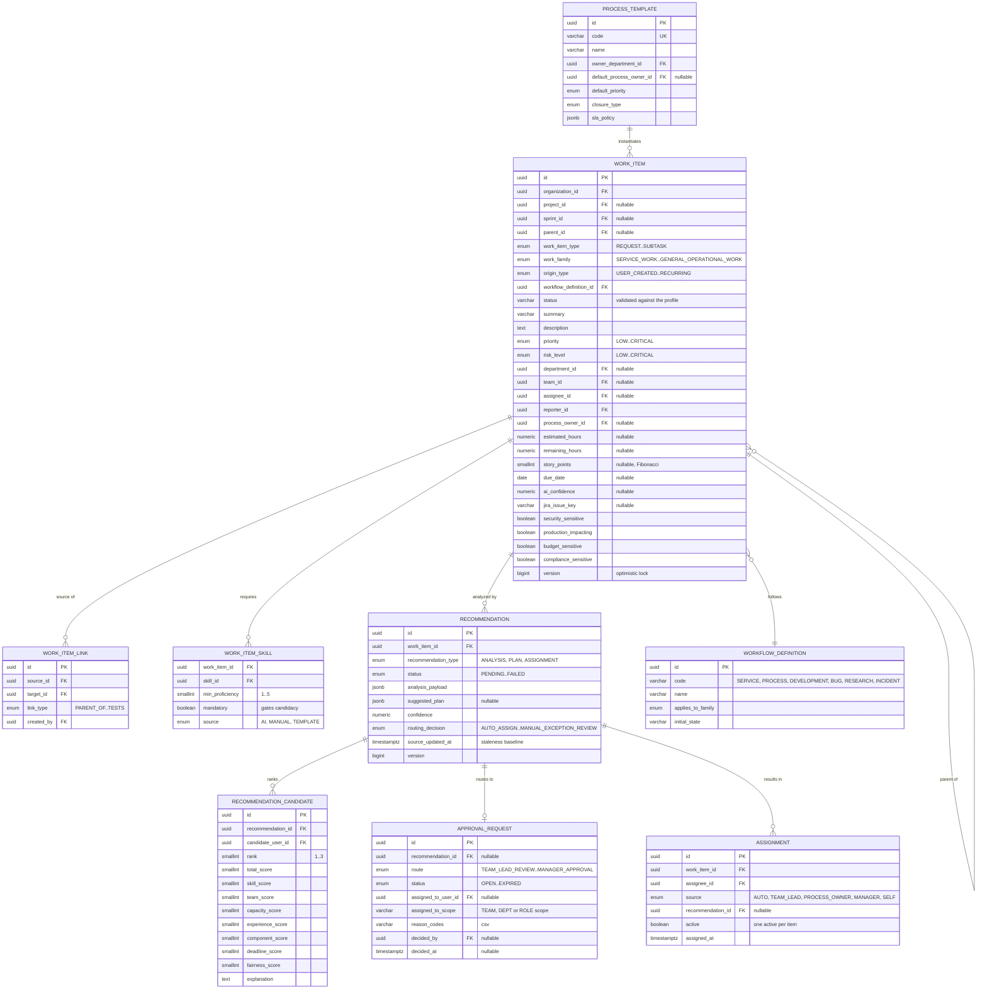
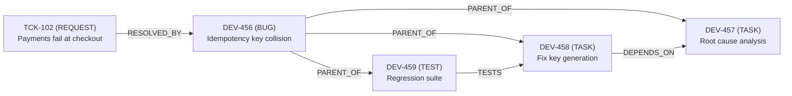

# 02 — Domain Model

## 1. The central decision: one Work Item table

Tickets, incidents, epics, features, stories, bugs, tasks and subtasks are **one entity** — `WorkItem` — discriminated by `work_item_type`. There is no separate `tickets` table.

Why this is the right call and not just convenience:

- The brief demands typed links *between* tickets and development items (`Ticket RESOLVED_BY Bug`). With separate tables that link needs polymorphic foreign keys, which Postgres cannot constrain.
- A Ticket and a Story go through the same machinery: AI analysis, decomposition, skill extraction, candidate ranking, policy routing, Jira sync. Duplicating that per entity type is the main source of bugs in this kind of system.
- Progress rollup, workload aggregation and reporting all need to traverse ticket→task→subtask uniformly.

The cost is that not every column applies to every type. That is handled by **type-aware validation** (§6), not by table splitting.

## 2. Work Item taxonomy

Three orthogonal classifications. Do not collapse them.

### 2.1 `work_item_type` — what it *is*

| Type | Typical parent | Story points? | Default workflow profile | Notes |
|---|---|---|---|---|
| `REQUEST` | none | no | `SERVICE` | What users call a "Ticket". Has a REQUESTER. |
| `INCIDENT` | none | no | `INCIDENT` | Unplanned disruption. Priority floor = HIGH. |
| `EPIC` | none / `PROJECT` | yes | `DEVELOPMENT` | Large development container. |
| `FEATURE` | `EPIC` | yes | `DEVELOPMENT` | Optional intermediate layer. |
| `STORY` | `EPIC`, `FEATURE` | yes | `DEVELOPMENT` | User-facing increment. Requires acceptance criteria. |
| `BUG` | any dev item, or none | yes | `BUG` | Defect. May be `RESOLVES` a REQUEST. |
| `TASK` | any | no | `DEVELOPMENT` or `SERVICE` | The universal unit of assignable work. |
| `TECHNICAL_DEBT` | `EPIC`, none | yes | `DEVELOPMENT` | Counted separately in the tech-debt ratio metric. |
| `RESEARCH` | any | no | `RESEARCH` | Time-boxed spike; produces findings, not shipped code. |
| `TEST` | `STORY`, `BUG`, `FEATURE` | no | `DEVELOPMENT` | Explicit test work item. |
| `DOCUMENTATION` | any | no | `DEVELOPMENT` | |
| `SUBTASK` | any non-`SUBTASK` | no | inherits parent's profile | Leaf only. Cannot itself have children. |

### 2.2 `work_family` — how it *behaves*

Selects defaults for workflow, SLA policy, template pool and reporting bucket.

| Family | Members | Default workflow | SLA tracked | Reporting bucket |
|---|---|---|---|---|
| `SERVICE_WORK` | `REQUEST`, and `TASK` generated from one | `SERVICE` | yes | Ticket metrics |
| `PROCESS_WORK` | multi-department process instances and their tasks | `PROCESS` | yes | Ticket + process metrics |
| `DEVELOPMENT_WORK` | `EPIC`…`DOCUMENTATION`, `SUBTASK` under them | `DEVELOPMENT` / `BUG` / `RESEARCH` | no | Development metrics |
| `INCIDENT_WORK` | `INCIDENT` and its children | `INCIDENT` | yes, tightest | Incident metrics |
| `GENERAL_OPERATIONAL_WORK` | recurring ops, admin tasks | `SERVICE` | optional | Capacity only |

Family is derived at creation by `WorkFamilyResolver` (type + parent + origin), can be overridden by AI analysis, and is then frozen unless a Team Lead explicitly redirects the item.

### 2.3 `origin_type` — where it *came from*

| Origin | Set when | Analytics meaning | Skips AI analysis? |
|---|---|---|---|
| `USER_CREATED` | created in the UI | planned or ad-hoc | no |
| `JIRA_IMPORTED` | pulled from Jira | pre-existing | no — analyzed on first import |
| `TICKET_GENERATED` | produced from a REQUEST's plan | unplanned, ticket-driven | already analyzed as part of the plan |
| `AI_GENERATED` | produced by decomposition | derived | no — each child is analyzed for skills/candidates |
| `PROCESS_TEMPLATE` | instantiated from a template | standard process | template supplies classification; AI only customizes |
| `PROJECT_PLANNING` | created during planning | planned | no |
| `INCIDENT_GENERATED` | produced from an INCIDENT | unplanned, urgent | no |
| `RECURRING` | created by a schedule | planned, repeating | yes — classification is inherited from the schedule |

**Planned vs unplanned** (a required report) is defined as: planned = `{USER_CREATED, PROJECT_PLANNING, PROCESS_TEMPLATE, RECURRING}`; unplanned = `{TICKET_GENERATED, INCIDENT_GENERATED}`; `AI_GENERATED` and `JIRA_IMPORTED` inherit from their root ancestor.

## 3. Domain diagram



## 4. Aggregates and transaction boundaries

| Aggregate | Root | Contains | Consistency rule |
|---|---|---|---|
| **Work Item** | `WorkItem` | skills, comments, attachments, its own status | One transaction per item. A parent and child are separate aggregates — rollup is eventually consistent and recomputed on child change. |
| **Recommendation** | `Recommendation` | candidates, approval request, routing decision | Approving is one transaction that also writes `Assignment`, the work item's assignee/status, an outbox event and an audit row. This is the one deliberate cross-aggregate transaction, and the reason for the monolith. |
| **Process instance** | root `WorkItem` (the REQUEST or process item) | generated children via `PARENT_OF` | Children are created in one transaction so a plan is never half-persisted. |
| **Sprint** | `Sprint` | membership, snapshot | Adding/removing items validates capacity but does not lock the items. |
| **Jira connection** | `JiraConnection` | tokens, mappings | Token refresh is isolated and serialized per connection. |

## 5. Typed relationships

`work_item_links` stores `(source_id, link_type, target_id)`. Twelve types, six inverse pairs:

| Type | Inverse | Semantics | Cycle check |
|---|---|---|---|
| `PARENT_OF` | `CHILD_OF` | hierarchy; also denormalized to `work_items.parent_id` | yes, strict |
| `BLOCKS` | *(implicit)* `DEPENDS_ON` | source must finish before target can start | yes |
| `DEPENDS_ON` | `BLOCKS` | target must finish first | yes |
| `DUPLICATES` | self-inverse | same underlying work | no |
| `RELATES_TO` | self-inverse | soft association | no |
| `RESOLVES` | `RESOLVED_BY` | dev item resolves a ticket/incident | no |
| `CAUSED_BY` | *(none)* | incident/bug root cause | no |
| `IMPLEMENTS` | *(none)* | task implements a story/feature | no |
| `GENERATED_FROM` | *(none)* | provenance: this item came from that one | no |
| `TESTS` | *(none)* | TEST item verifies target | no |

### Rules

1. **Canonical storage.** Inverse pairs are stored once in the canonical direction (`PARENT_OF`, `BLOCKS`, `RESOLVED_BY`) and presented in both directions by the read model. This makes uniqueness enforceable: `UNIQUE (source_id, link_type, target_id)`.
2. **`PARENT_OF` is doubly represented.** The link table holds it for uniform traversal; `work_items.parent_id` holds it for cheap queries. A DB constraint plus an integration test keep them in step.
3. **Cycle prevention.** `PARENT_OF`, `BLOCKS` and `DEPENDS_ON` are validated with a recursive CTE before insert. Violation → `400 LINK_CYCLE_DETECTED`.
4. **Type legality.** A matrix restricts nonsense: `SUBTASK` may not be `PARENT_OF` anything; `TESTS` requires source type `TEST`; `RESOLVES` requires target family `SERVICE_WORK` or `INCIDENT_WORK`.
5. **Cross-family links are expected.** A `RESOLVED_BY` from a `REQUEST` to a `BUG` is the core ticket→development conversion and must not be blocked.

### Worked example (from the brief)



Stored canonically as five rows; `T1 BLOCKS T2` is rendered from the `DEPENDS_ON` row.

## 6. Type-aware validation

One entity, many shapes. Enforced by `WorkItemValidator` at the application layer (not by DB nullability, which cannot express conditionality).

| Rule | Applies to |
|---|---|
| `summary` required, 5–255 chars | all |
| `reporterId` required | all |
| `parentId` must be null | `REQUEST`, `INCIDENT`, `EPIC` |
| `parentId` required | `SUBTASK` |
| parent must not be `SUBTASK` | all |
| `storyPoints` must be null | `REQUEST`, `INCIDENT`, `TASK`, `SUBTASK`, `RESEARCH`, `TEST`, `DOCUMENTATION` |
| `storyPoints` ∈ {1,2,3,5,8,13,21} when present | `EPIC`, `FEATURE`, `STORY`, `BUG`, `TECHNICAL_DEBT` |
| acceptance criteria required before leaving `READY` | `STORY`, `FEATURE` |
| `projectId` required | `EPIC`, `FEATURE`, `STORY`, `TECHNICAL_DEBT` |
| `projectId` optional | everything else |
| `sprintId` requires the item to be a leaf or a `STORY`/`BUG` | development family |
| `priority` defaults `HIGH`, may not be `LOW` | `INCIDENT` |
| `dueDate` must be ≥ today at creation | all |
| `estimatedHours` ∈ (0, 200] | all when present |
| interns: see [08](08-policy-and-assignment.md) level restrictions | assignment time |

**Deliberately absent:** `ticket_id`. There is no such column. Ticket linkage is a `GENERATED_FROM` or `RESOLVED_BY` link.

## 7. Status and workflow binding

`work_items.status` is a `VARCHAR`, not an enum, because the legal set depends on the item's `workflow_definition_id`. Integrity is enforced by:

- FK-like validation: `(workflow_definition_id, status)` must exist in `workflow_states`.
- Every change goes through `WorkflowEngine.transition(item, targetState, actor)` which checks `workflow_transitions` for a row matching `(definition, from, to)`, evaluates the transition's guard, and checks the actor's permission.
- The API accepts a **transition name**, never a raw status string: `POST /work-items/{id}/transition { "transition": "START_WORK" }`. The frontend cannot invent a status.

Details in [04-workflows.md](04-workflows.md).

## 8. Parent progress

Three strategies, chosen per parent type. Computed on demand, cached on the parent row, invalidated by a child status/estimate change.

| Parent type | Strategy | Formula |
|---|---|---|
| `REQUEST`, `INCIDENT`, process roots | **estimate-weighted** | `Σ estimated_hours(done children) / Σ estimated_hours(all children)` |
| `EPIC`, `FEATURE` | **story-point-weighted** | `Σ story_points(done children) / Σ story_points(all children)` |
| `STORY`, `BUG`, `TASK` | **count-based** | `count(done children) / count(all children)` |
| any, fallback | **count-based** | used when the weighting field is missing on ≥ 30% of children |

Rules:
- Only direct children count. Grandchildren roll up through their own parent.
- "Done" means the child's status is flagged `terminal_success` in `workflow_states` (`DONE`, `CLOSED`, `COMPLETED`, `VERIFIED`, `RESOLVED`).
- Cancelled children are excluded from both numerator and denominator.
- A parent with no children reports progress from its own status: 0% or 100%.
- Blocked children count as incomplete but raise a `hasBlockedChildren` flag surfaced on the parent card.

## 9. Skills

```
skills            (id, organization_id, code, name, category, active)
user_skills       (user_id, skill_id, proficiency 1..5, years_experience, last_used_at)
work_item_skills  (work_item_id, skill_id, min_proficiency, mandatory, source)
```

- `code` is canonical and uppercase-snake: `SPRING_BOOT`, `MICROSOFT_365`, `IDENTITY_MANAGEMENT`, `OBJECT_STORAGE`, `INTEGRATION_TESTING`.
- Categories: `LANGUAGE`, `FRAMEWORK`, `PLATFORM`, `TOOL`, `DOMAIN`, `PROCESS`, `SOFT`.
- AI returns skill codes. `SkillResolver` maps them case-insensitively with an alias table (`springboot` → `SPRING_BOOT`). **Unmatched codes are recorded on the recommendation as `unresolvedSkills` and shown to the Admin for curation — they are never auto-created.** This keeps the taxonomy from degrading over a demo.
- `mandatory` skills gate candidacy (a candidate lacking one is excluded). Non-mandatory skills only affect the score.

## 10. Work item identity and keys

| Identifier | Purpose |
|---|---|
| `id` (UUID v7) | Primary key. v7 is time-ordered, so index locality is good and creation order is recoverable. |
| `reference_key` | Human key, e.g. `TCK-102`, `DEV-456`. Generated per project (or per organization for tickets) from a sequence. Shown everywhere in the UI. |
| `jira_issue_key` | Jira's key, e.g. `PLAT-88`. Null until synced. **Never used as a local identifier.** |

Keeping `reference_key` independent of Jira means the platform is fully usable before, during and after a Jira outage, and imported items do not collide with locally created ones.

## 11. Domain events

Published in-process via Spring Modulith `@ApplicationModuleListener` and mirrored to the outbox where an external effect is needed.

| Event | Published by | Consumed by |
|---|---|---|
| `WorkItemCreated` | workitem | recommendation, jira, audit, notification |
| `WorkItemAnalysisRequested` | workitem, recommendation | recommendation |
| `WorkItemAnalysisCompleted` | recommendation | policy, notification, reporting |
| `MoreInformationRequested` | recommendation | notification |
| `WorkItemPlanGenerated` | recommendation | workitem, process, notification |
| `AssignmentRecommended` | assignment | policy, notification |
| `AssignmentAutoApproved` | policy | workitem, jira, audit, notification |
| `AssignmentApproved` | recommendation | workitem, jira, audit, notification |
| `WorkItemStarted` | workflow | reporting, jira |
| `WorkItemBlocked` | workflow | notification, reporting |
| `WorkItemCompleted` | workflow | workitem (progress), jira, reporting |
| `JiraSyncRequested` | multiple | outbox relay |
| `JiraSyncCompleted` | jira | audit, reporting |
| `SprintClosed` | sprint | reporting |
| `SprintReportGenerated` | reporting | notification |

## 12. Enumerations (single source of truth)

```
WorkItemType   REQUEST INCIDENT EPIC FEATURE STORY BUG TASK TECHNICAL_DEBT
               RESEARCH TEST DOCUMENTATION SUBTASK
WorkFamily     SERVICE_WORK PROCESS_WORK DEVELOPMENT_WORK INCIDENT_WORK
               GENERAL_OPERATIONAL_WORK
OriginType     USER_CREATED JIRA_IMPORTED TICKET_GENERATED AI_GENERATED
               PROCESS_TEMPLATE PROJECT_PLANNING INCIDENT_GENERATED RECURRING
LinkType       PARENT_OF CHILD_OF BLOCKS DEPENDS_ON DUPLICATES RELATES_TO
               RESOLVES RESOLVED_BY CAUSED_BY IMPLEMENTS GENERATED_FROM TESTS
Priority       LOW MEDIUM HIGH CRITICAL
RiskLevel      LOW MEDIUM HIGH CRITICAL
Complexity     LOW MEDIUM HIGH
EmployeeLevel  INTERN JUNIOR MID SENIOR LEAD
SystemRole     EMPLOYEE TEAM_LEAD MANAGER ADMIN
ResourceRole   REQUESTER ASSIGNEE PROCESS_OWNER WATCHER APPROVER REVIEWER
ApprovalRoute  AUTO_ASSIGN TEAM_LEAD_REVIEW PROCESS_OWNER_REVIEW
               MANAGER_APPROVAL REQUEST_MORE_INFORMATION MANUAL_EXCEPTION_REVIEW
RecStatus      PENDING AWAITING_APPROVAL APPROVED REJECTED APPLIED STALE
               SUPERSEDED FAILED
ClosureType    AUTO_CLOSE REQUESTER_VERIFICATION PROCESS_OWNER_VERIFICATION
               TEAM_LEAD_VERIFICATION
OutboxStatus   PENDING IN_PROGRESS COMPLETED FAILED DEAD_LETTER
```

These names are used verbatim in Java enums, Pydantic literals, TypeScript union types and the database. No translation layer, no synonyms.
