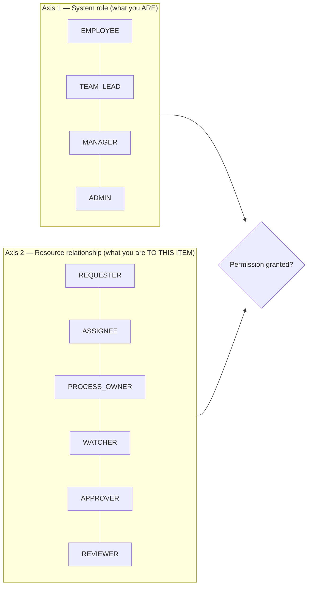
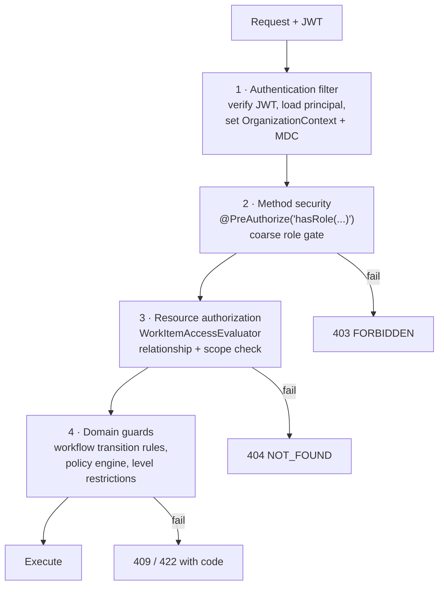

# 03 — Roles & Authorization

## 1. Two independent axes

Authorization is the **intersection** of two things that are frequently conflated:



**Axis 1 — System roles** are global, coarse, and stored in `user_roles`. A user may hold several. They answer "what kind of user is this".

**Axis 2 — Resource relationships** are per-work-item, derived at evaluation time, and never stored as global roles. They answer "what is this user to *this specific item*".

### Why REQUESTER and PROCESS_OWNER are not roles

The brief is explicit and correct on this point:

- An employee who files a ticket is the **REQUESTER of that ticket**. They are not "a Requester" in the organization. Making it a role would mean anyone who ever filed a ticket permanently holds requester privileges over every ticket.
- A user may own the onboarding process for one ticket and own nothing else. Making PROCESS_OWNER global would mean owning every process in the company.

So the same person, in one session, can be: `EMPLOYEE` + `TEAM_LEAD` (system roles), REQUESTER on TCK-77, PROCESS_OWNER on TCK-102, ASSIGNEE on DEV-457, and WATCHER on EPIC-9. All simultaneously, all correct.

### Where relationships come from

| Relationship | Derived from |
|---|---|
| `REQUESTER` | `work_items.reporter_id` on a `REQUEST`/`INCIDENT` |
| `ASSIGNEE` | `work_items.assignee_id` |
| `PROCESS_OWNER` | `work_items.process_owner_id`, or a row in `process_owners` for the item or any ancestor |
| `WATCHER` | a row in `work_item_watchers` |
| `APPROVER` | an open `approval_requests` row targeted at this user or at a scope they satisfy |
| `REVIEWER` | assigned reviewer on an item in a `CODE_REVIEW` / `FINDINGS_REVIEW` state |

`ProcessOwner` inherits **down** the hierarchy: the owner of an epic is the process owner of its stories and tasks unless one of them names a different owner. This is how "Process Owner sees cross-team plans" works without listing every task.

## 2. System roles

| Role | Scope of visibility | Core competence |
|---|---|---|
| `EMPLOYEE` | own work + own tickets + items they watch + parent context of those | executing work |
| `TEAM_LEAD` | their team(s) and, if they lead a department-level team, their department | reviewing, redirecting, capacity |
| `MANAGER` | their department, or the organization if flagged `organization_wide` | escalations, exceptions, policy |
| `ADMIN` | configuration everywhere; **not** an operational work owner | configuration and integration |

Notes:

- `TEAM_LEAD` implies `EMPLOYEE` capabilities on their own assigned items. Roles are additive, never subtractive.
- `ADMIN` deliberately does **not** grant operational approval authority. An Admin who needs to approve work must also hold `MANAGER`. This prevents "admin as god-mode" and keeps the audit trail meaningful.
- `MANAGER` scope is bounded by department unless `users.organization_wide = true` (the executive in the seed data).

## 3. Permission matrix

`✔` = allowed. `▲` = allowed only when the resource relationship in the note holds. `—` = denied.

### 3.1 Work items — read

| Capability | EMPLOYEE | TEAM_LEAD | MANAGER | ADMIN |
|---|---|---|---|---|
| View work item assigned to them | ✔ | ✔ | ✔ | ✔ |
| View ticket they created | ▲ REQUESTER | ✔ | ✔ | ✔ |
| View item they watch | ▲ WATCHER | ✔ | ✔ | ✔ |
| View parent Ticket/Story/Epic context of their item | ✔ | ✔ | ✔ | ✔ |
| View any item in their team | — | ✔ | ✔ | — |
| View any item in their department | — | ▲ dept-level lead | ✔ | — |
| View any item in the organization | — | — | ▲ `organization_wide` | — |
| View items they own as process owner (any dept) | ▲ PROCESS_OWNER | ▲ | ▲ | ▲ |
| View confidential/security-flagged item | ▲ ASSIGNEE only | ▲ own team | ✔ | — |

### 3.2 Work items — write

| Capability | EMPLOYEE | TEAM_LEAD | MANAGER | ADMIN |
|---|---|---|---|---|
| Create `REQUEST` / `INCIDENT` | ✔ | ✔ | ✔ | ✔ |
| Create `TASK`, `BUG`, `RESEARCH`, `DOCUMENTATION` | ✔ within own team/project | ✔ | ✔ | — |
| Create `EPIC`, `FEATURE`, `STORY` | — | ✔ | ✔ | — |
| Create `SUBTASK` under own item | ▲ ASSIGNEE | ✔ | ✔ | — |
| Edit summary/description | ▲ ASSIGNEE or REQUESTER | ✔ team | ✔ dept | — |
| Start / block / complete a task | ▲ ASSIGNEE | ✔ team | ✔ dept | — |
| Submit for review | ▲ ASSIGNEE | ✔ | ✔ | — |
| Update remaining effort | ▲ ASSIGNEE | ✔ | ✔ | — |
| Comment / attach | ▲ any visible item | ✔ | ✔ | ✔ |
| Answer AI clarification questions | ▲ REQUESTER or ASSIGNEE | ✔ | ✔ | — |
| Request reassignment | ▲ ASSIGNEE | n/a | n/a | — |
| **Assign a task to another person** | **—** | ✔ within team | ✔ within dept | — |
| Change team/department (redirect) | — | ✔ | ✔ | — |
| Change priority | — | ✔ up to HIGH | ✔ incl. CRITICAL | — |
| Set security/production/budget flags | — | ✔ set only | ✔ set and clear | — |
| Delete a work item | — | — | ✔ soft, with reason | ✔ soft |

The bolded row is the one users try hardest to route around: an Employee can *request* reassignment, which creates an approval request for their Team Lead, but can never hand work to a colleague directly. It keeps workload data honest.

### 3.3 Workflow transitions

Transitions are permissioned individually in `workflow_transitions.allowed_roles` (system roles) and `allowed_relationships` (resource relationships). Representative rules:

| Transition | Who |
|---|---|
| `START_WORK` (TODO → IN_PROGRESS) | ASSIGNEE, TEAM_LEAD |
| `BLOCK` (any active → BLOCKED, reason required) | ASSIGNEE, TEAM_LEAD |
| `UNBLOCK` | ASSIGNEE, TEAM_LEAD |
| `SUBMIT_FOR_REVIEW` (IN_PROGRESS → CODE_REVIEW) | ASSIGNEE |
| `APPROVE_REVIEW` (CODE_REVIEW → TESTING) | REVIEWER, TEAM_LEAD — **never the ASSIGNEE** |
| `REJECT_REVIEW` (CODE_REVIEW → IN_PROGRESS) | REVIEWER, TEAM_LEAD |
| `PASS_QA` (TESTING/QA → DONE/VERIFIED) | REVIEWER, TEAM_LEAD |
| `RESOLVE` (→ RESOLVED) | ASSIGNEE |
| `VERIFY` (RESOLVED → CLOSED) | REQUESTER, PROCESS_OWNER, TEAM_LEAD |
| `REOPEN` | REQUESTER, PROCESS_OWNER, TEAM_LEAD, MANAGER |
| `CLOSE_PROCESS` | PROCESS_OWNER, MANAGER |
| `ESCALATE` | TEAM_LEAD, PROCESS_OWNER |
| `CANCEL` | TEAM_LEAD, MANAGER |

Two hard guards, enforced in `TransitionValidator` rather than in configuration so they cannot be misconfigured away:

1. **Self-review is impossible.** `APPROVE_REVIEW` and `PASS_QA` reject the request if `actor == item.assigneeId`.
2. **Review and test stages cannot be skipped.** There is no transition edge from `IN_PROGRESS` to `DONE` in the development or bug profiles. A Manager cannot force one; they can only `CANCEL`.

### 3.4 Recommendations and approvals

| Capability | EMPLOYEE | TEAM_LEAD | MANAGER | ADMIN |
|---|---|---|---|---|
| View recommendation on an item they can see | ✔ read-only | ✔ | ✔ | ✔ |
| View AI explanation panel | ✔ | ✔ | ✔ | ✔ |
| Trigger analyze / reanalyze | ▲ REQUESTER, once per 5 min | ✔ | ✔ | — |
| See the review queue | — | ✔ own team/dept | ✔ own dept | — |
| Edit a recommendation before approving | — | ✔ `TEAM_LEAD_REVIEW` items | ✔ any route | — |
| Approve `TEAM_LEAD_REVIEW` | — | ✔ | ✔ | — |
| Approve `PROCESS_OWNER_REVIEW` | ▲ PROCESS_OWNER | ▲ PROCESS_OWNER | ▲ PROCESS_OWNER | ▲ PROCESS_OWNER |
| Approve `MANAGER_APPROVAL` | — | — | ✔ | — |
| Approve `MANUAL_EXCEPTION_REVIEW` | — | ✔ | ✔ | ✔ |
| Reject with reason | same as approve | | | |
| Regenerate recommendation | — | ✔ | ✔ | — |
| Escalate to the next route | — | ✔ | n/a | — |

`PROCESS_OWNER_REVIEW` is the row that shows why the two axes matter: the approver is whoever owns *that* item, regardless of their system role. An `EMPLOYEE` who is the HR Operations process owner approves cross-department onboarding plans that a `TEAM_LEAD` from Engineering cannot touch.

**A Manager may act on any lower route** (Manager can approve a `TEAM_LEAD_REVIEW` item in their department). The reverse is never true. This is `route ≤ actor authority`, not exact matching, so escalation is always possible and de-escalation never is.

### 3.5 Team Lead operations

| Capability | Scope |
|---|---|
| Team dashboard, backlog, workload, review queue | own team(s); own department if department-level lead |
| Unassigned / blocked / overdue queues | same |
| Change assignee | within their team only; cross-team requires redirect |
| Redirect misclassified item to another team/department | any target; creates a `PROCESS_OWNER_REVIEW` if it crosses departments |
| Review and edit AI decomposition | items in their scope |
| Add/remove from sprint | sprints of their team |
| Handle blocked items | own team |
| Escalate to Manager | creates `MANAGER_APPROVAL` approval request with a required reason |
| Team reports | own scope, aggregate only — never per-person scoring |

### 3.6 Process Owner operations

| Capability | Notes |
|---|---|
| View owned tickets, epics, features and their whole subtree | crosses department boundaries by design |
| View cross-department task plans / cross-team development plans | the primary reason the role exists |
| Approve or edit a non-standard decomposition | `PROCESS_OWNER_REVIEW` route |
| Define / verify business objective, review acceptance criteria | on owned items |
| Track dependencies and delayed items | read across the subtree |
| Contact relevant Team Leads | creates notifications, not assignments |
| Escalate a blocked process | → `MANAGER_APPROVAL` |
| Verify and close the parent ticket/feature | when `closure_type` requires it |

**Explicitly not permitted:** assigning individual employees. A process owner approves the *plan*; the assignment engine and Team Leads own the *people*. This is the boundary that stops process owners from becoming shadow managers.

### 3.7 Manager operations

| Capability | Notes |
|---|---|
| Critical work, incidents, escalations, SLA risk | department scope, or org-wide if flagged |
| Department capacity, project and sprint risk | aggregate |
| Resolve cross-team priority conflicts | may reprioritize across teams in their department |
| Approve policy exceptions | writes an `approval_requests` row with `exception=true` |
| Approve security / budget / production / legal-sensitive work | the `MANAGER_APPROVAL` route |
| Configure high-level automation policies | thresholds only — see the Admin/Manager split below |
| Organizational reports, planned vs unplanned, AI acceptance metrics | read |

**Explicitly not permitted:** approving routine low-risk tasks. There is no UI path to a `AUTO_ASSIGN` item's approval, because it never generates one. If managers start appearing in low-risk approvals it means a policy is misconfigured, and the AI-metrics dashboard surfaces that as a falling auto-assignment rate.

### 3.8 Admin operations

| Capability | Notes |
|---|---|
| Jira integration: OAuth connect, projects, boards, mappings, webhook config | |
| Users, roles, departments, teams, skills, projects | |
| Process templates, workflow profiles/definitions | |
| Assignment policies, employee-level policies, AI confidence thresholds | |
| Employee-level restrictions | |
| Audit log access | read-only, cannot delete |

**Admin / Manager split on policy:** the Admin defines the *mechanism* (which conditions map to which route, what the weights are). The Manager sets the *aggressiveness* (auto-assign confidence threshold, workload ceiling) within bounds the Admin configures. Every policy change is audited with before/after. Admins cannot approve operational work and cannot assign tasks.

## 4. Enforcement design

Four layers. A permission must pass all of them.



### Layer 3 in detail

```java
// signature only — Phase 1 is design; implementation is Phase 2/3
public interface WorkItemAccessEvaluator {
    boolean canRead(Principal actor, UUID workItemId);
    boolean canWrite(Principal actor, UUID workItemId, WriteOperation op);
    Set<ResourceRole> relationshipsOf(Principal actor, UUID workItemId);
}
```

Used from controllers as `@PreAuthorize("@workItemAccess.canRead(principal, #id)")` and, more importantly, **pushed into queries**: list endpoints do not fetch-then-filter. `WorkItemQueryBuilder` appends a visibility predicate derived from the principal, so an employee's `GET /work-items` is a single SQL statement that can only return items they may see. Fetch-then-filter leaks existence through pagination counts.

### Not-found vs forbidden

Requesting an item that exists but is invisible returns **404**, not 403. Returning 403 confirms the item exists and leaks the ID space. 403 is reserved for "you can see it but may not do that to it".

### Isolation

| Boundary | Mechanism |
|---|---|
| Organization | `OrganizationContext` from JWT → Hibernate `@Filter` on every business entity + an integration test that asserts cross-org reads return empty |
| Department | predicate on `work_items.department_id ∈ actor.visibleDepartments` |
| Team | predicate on `work_items.team_id ∈ actor.teamIds` |
| Confidential items | `security_sensitive = true` narrows visibility to assignee, process owner, department manager and admins |

## 5. Frontend role handling

The frontend uses roles for **navigation and affordances only**. It is not a security boundary.

- `GET /api/v1/auth/me` returns system roles, team/department scope, and a `capabilities` array of coarse feature flags.
- `<RequireRole>` and `<RequireCapability>` guards hide routes and controls.
- Every item detail response includes a per-item `permissions` object (`{ canEdit, canTransition: ["START_WORK","BLOCK"], canApprove, canAssign }`) so buttons reflect real backend authority rather than a client-side guess.
- Hiding a button never substitutes for a server check; there is a security test per endpoint asserting the 403/404 path.

## 6. Authorization test plan (Phase 3 and 6)

| Test | Asserts |
|---|---|
| `EmployeeCannotAssignOthersTest` | 403 on assigning a task to a colleague, via every route including the MCP tool |
| `CrossOrganizationIsolationTest` | every list endpoint returns empty for a foreign org; every get returns 404 |
| `TeamLeadScopeTest` | lead of Team A gets 404 on a Team B item, 200 on their own |
| `ProcessOwnerCrossDepartmentTest` | a non-lead EMPLOYEE process owner can read and approve a plan spanning HR + IT + Finance |
| `ManagerCannotApproveRoutineTest` | no approval request is ever created for an `AUTO_ASSIGN` outcome |
| `SelfReviewForbiddenTest` | assignee cannot execute `APPROVE_REVIEW` on their own item |
| `ReviewStageCannotBeSkippedTest` | no transition path exists from `IN_PROGRESS` to `DONE` for any actor |
| `AdminIsNotOperationalTest` | admin gets 403 on assign, approve and transition endpoints |
| `SensitiveItemVisibilityTest` | security-flagged item invisible to unrelated team members |
| `McpRespectsPolicyTest` | `create_assignment_recommendation` via MCP produces the same route as the REST path and cannot force `AUTO_ASSIGN` |
| `ListEndpointsAreQueryFilteredTest` | pagination totals for a restricted user match the visible set, proving no fetch-then-filter |
