# 04 — Workflows

## 1. Configurable workflow profiles

There is no single global status enum. Each work item is bound at creation to a `workflow_definition`, and its legal states and transitions come from `workflow_states` and `workflow_transitions`.

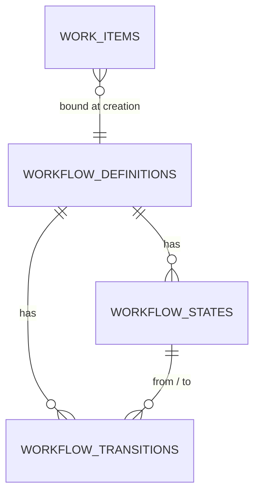

### Profile selection

| Work item type / family | Profile code |
|---|---|
| `REQUEST`, `GENERAL_OPERATIONAL_WORK`, tasks under a request | `SERVICE` |
| process root + tasks in `PROCESS_WORK` | `PROCESS` |
| `EPIC`, `FEATURE`, `STORY`, `TASK`, `TECHNICAL_DEBT`, `TEST`, `DOCUMENTATION` | `DEVELOPMENT` |
| `BUG` | `BUG` |
| `RESEARCH` | `RESEARCH` |
| `INCIDENT` | `INCIDENT` |
| `SUBTASK` | inherits its parent's profile |

The binding is stored as `work_items.workflow_definition_id` and does not change if the admin later edits the profile — existing items keep their definition version. Admins can create additional profiles (e.g. `DEVELOPMENT_NO_QA` for a team without a QA stage) and set them as the default for a team or project.

### State metadata

Every row in `workflow_states` carries flags used across the platform:

| Flag | Used by |
|---|---|
| `is_initial` | creation |
| `is_terminal` | progress, reporting, sprint carry-over |
| `is_terminal_success` | progress numerator, "done" definition |
| `is_active_work` | workload calculation (hours count against capacity) |
| `is_blocked` | blocked queues, blocked-duration metric |
| `is_waiting_external` | SLA clock pause |
| `category` | board column mapping: `TODO / IN_PROGRESS / BLOCKED / REVIEW / TESTING / DONE` |

`category` is what lets one board render items from six different profiles side by side on My Work.

## 2. The six profiles

### 2.1 SERVICE

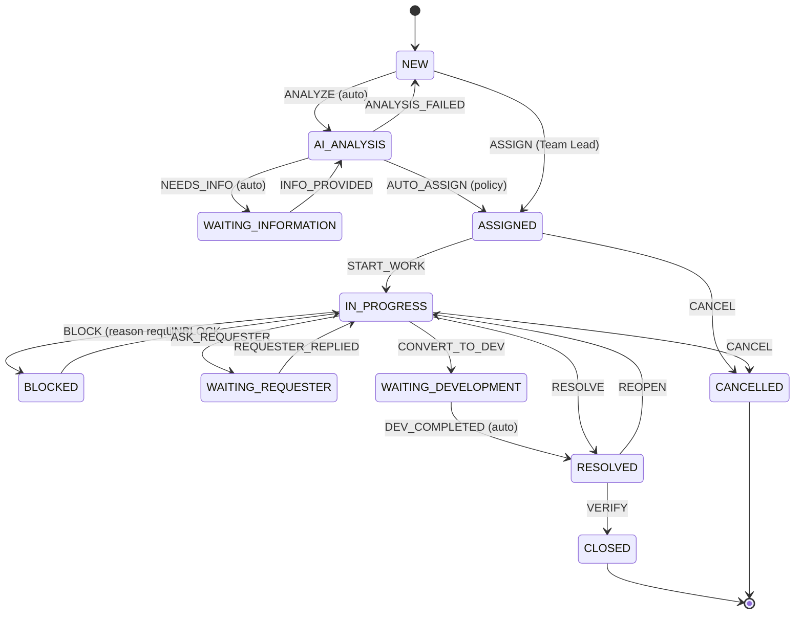

`WAITING_DEVELOPMENT` and `BLOCKED` are additions to the brief's minimal list. `WAITING_DEVELOPMENT` is required by Demo 3; `BLOCKED` is required because Employees must be able to block a task with a reason and Team Leads need a blocked queue.

State categories: `NEW/AI_ANALYSIS/WAITING_INFORMATION/ASSIGNED → TODO`, `IN_PROGRESS/WAITING_REQUESTER/WAITING_DEVELOPMENT → IN_PROGRESS`, `BLOCKED → BLOCKED`, `RESOLVED/CLOSED → DONE`.

SLA clock pauses in `WAITING_INFORMATION`, `WAITING_REQUESTER` and `BLOCKED`.

### 2.2 PROCESS

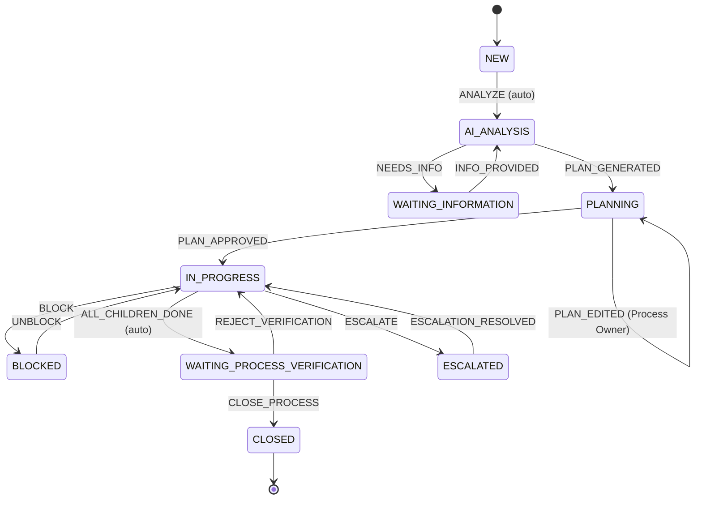

`ALL_CHILDREN_DONE` is an automatic transition fired by the progress calculator when estimate-weighted progress reaches 100% and no child is blocked. `CLOSE_PROCESS` is restricted to `PROCESS_OWNER` and `MANAGER`.

### 2.3 DEVELOPMENT

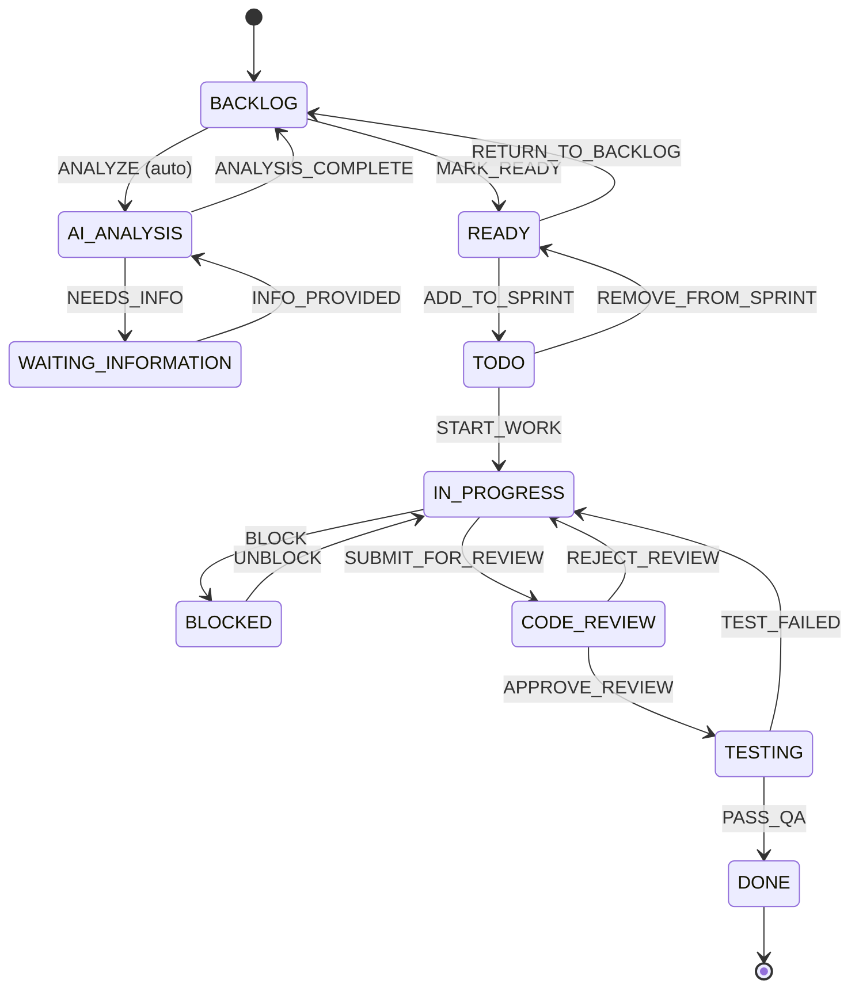

`MARK_READY` has a guard: acceptance criteria must be present for `STORY` and `FEATURE`, and there must be no unresolved `DEPENDS_ON` link to an unfinished item. **There is no `IN_PROGRESS → DONE` edge.** Review and testing are structurally unskippable.

### 2.4 BUG

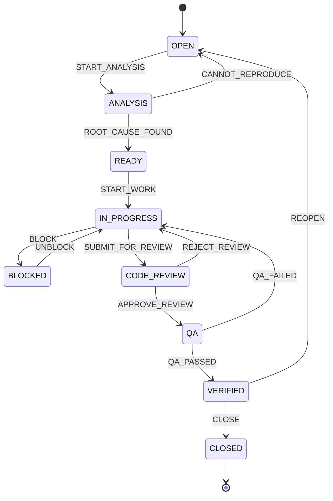

Reaching `VERIFIED` or `CLOSED` fires `BugResolved`, which is what moves a linked ticket out of `WAITING_DEVELOPMENT` (§5).

### 2.5 RESEARCH

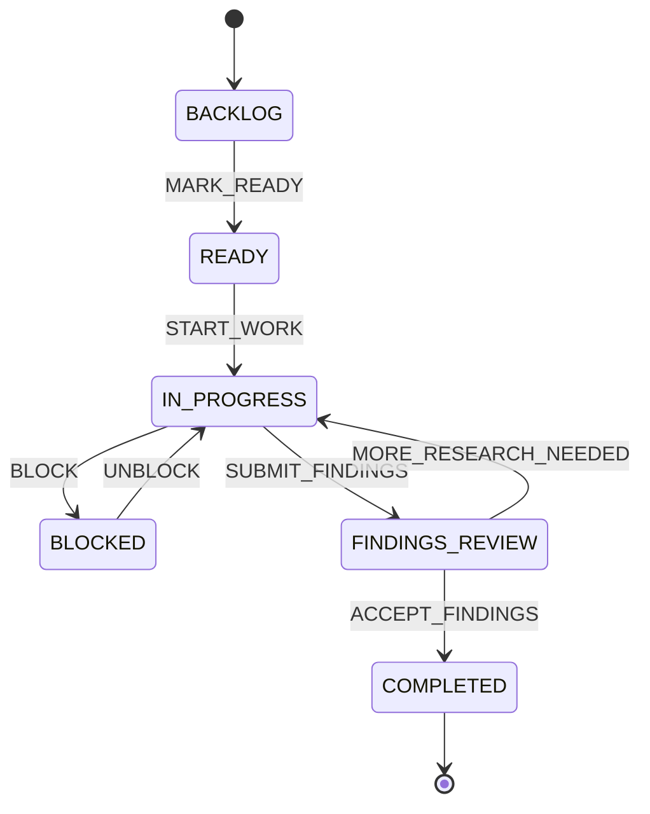

Research items are time-boxed: `estimated_hours` is mandatory, and exceeding it by 50% raises a notification to the Team Lead rather than silently continuing.

### 2.6 INCIDENT

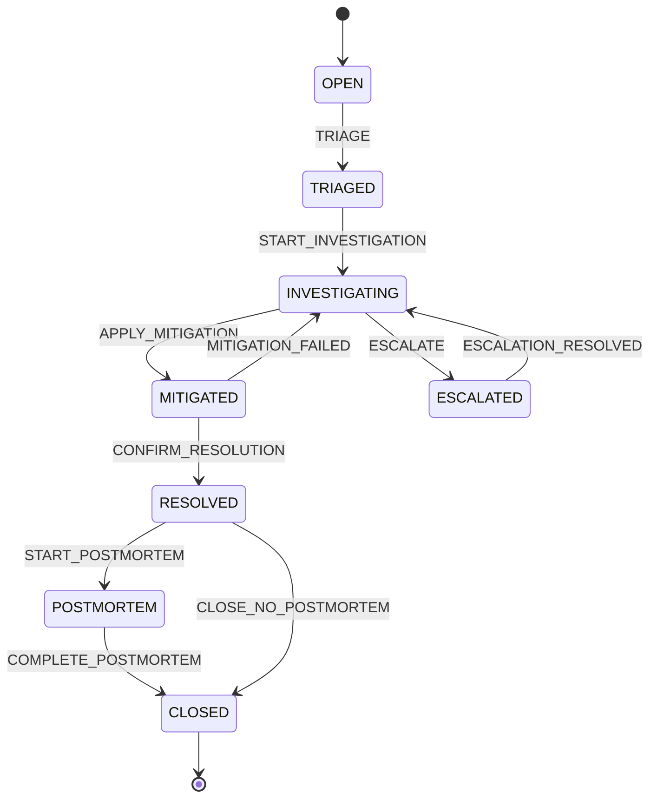

Guard: `CLOSE_NO_POSTMORTEM` is unavailable when `priority = CRITICAL` or `production_impacting = true` — those incidents must go through `POSTMORTEM`.

## 3. Ticket-originated end-to-end flow

The 25 steps from the brief, as an executable sequence.

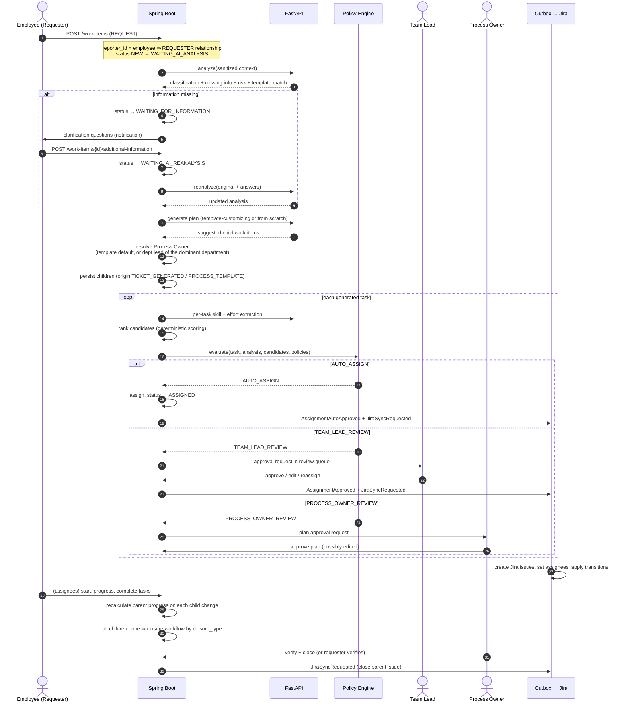

### Closure types

`closure_type` comes from the process template, or defaults by family.

| Closure type | Who closes | Default for |
|---|---|---|
| `AUTO_CLOSE` | system, when all children are done | `GENERAL_OPERATIONAL_WORK` |
| `REQUESTER_VERIFICATION` | the REQUESTER | `SERVICE_WORK` |
| `PROCESS_OWNER_VERIFICATION` | the PROCESS_OWNER | `PROCESS_WORK` |
| `TEAM_LEAD_VERIFICATION` | the owning Team Lead | `INCIDENT_WORK` |

If the verifier does not act within the configured window, a reminder is raised; the item is never auto-closed against a non-`AUTO_CLOSE` policy.

## 4. Development end-to-end flow

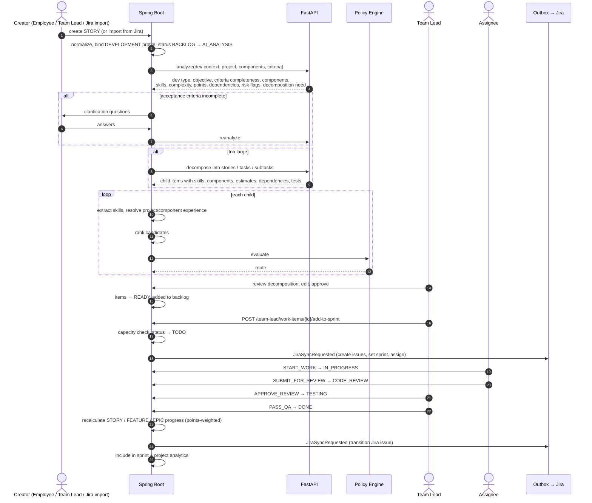

## 5. Ticket → development conversion

The mechanism behind Demo 3.

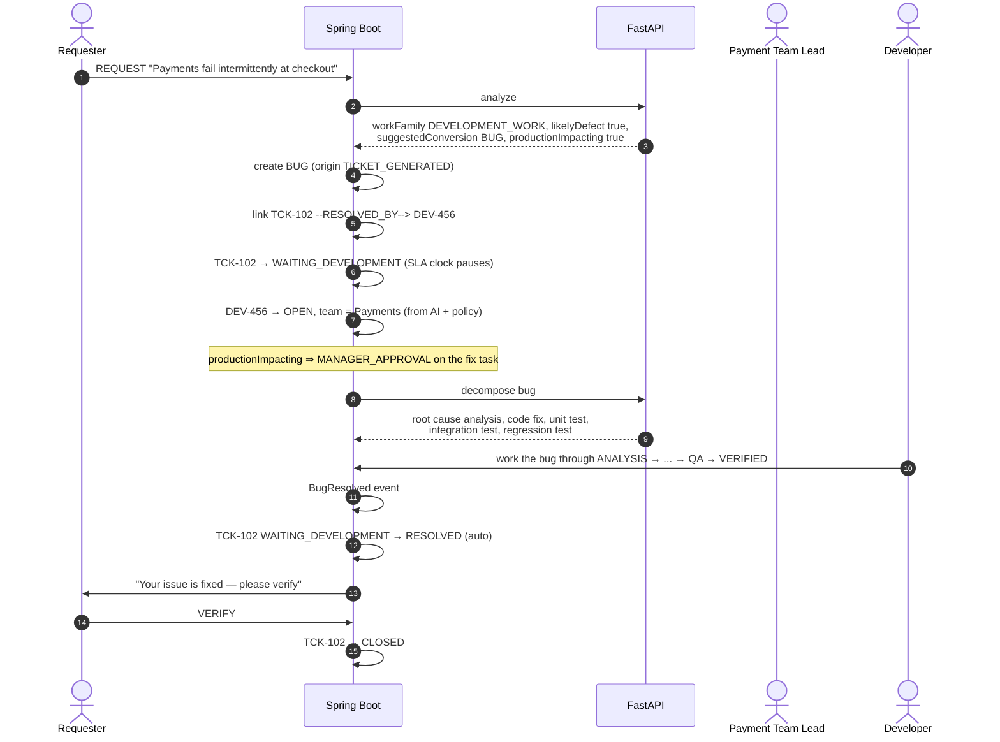

Rules:

1. Conversion **never deletes or replaces** the ticket. The ticket remains the requester's window into progress.
2. The link is `RESOLVED_BY` in canonical direction (`Ticket RESOLVED_BY Bug`), rendered as `RESOLVES` on the bug.
3. `WAITING_DEVELOPMENT` pauses the ticket's SLA clock, and the ticket's progress mirrors the bug's progress.
4. The ticket returns to `RESOLVED` when **all** items linked `RESOLVED_BY` reach a terminal-success state. Multiple bugs may resolve one ticket.
5. The requester always verifies, regardless of who fixed it. `closure_type` on a converted ticket is forced to `REQUESTER_VERIFICATION`.
6. If the requester rejects, the ticket reopens and a new `BUG` may be linked; the old link is retained for history.

## 6. Transition validation

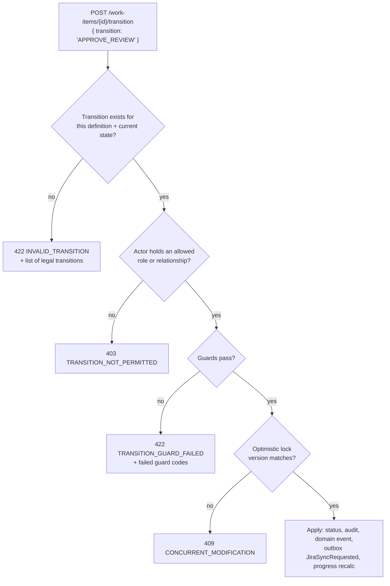

### Guard catalogue

| Guard | Fails when |
|---|---|
| `REQUIRE_REASON` | `BLOCK`, `REJECT_REVIEW`, `CANCEL`, `ESCALATE` submitted without a reason ≥ 10 chars |
| `REQUIRE_ASSIGNEE` | moving into an `is_active_work` state with no assignee |
| `NOT_SELF_REVIEW` | actor is the assignee on `APPROVE_REVIEW` / `PASS_QA` / `QA_PASSED` |
| `NO_OPEN_DEPENDENCIES` | `START_WORK` while a `DEPENDS_ON` target is not terminal-success |
| `REQUIRE_ACCEPTANCE_CRITERIA` | `MARK_READY` on a `STORY`/`FEATURE` with empty criteria |
| `ALL_CHILDREN_TERMINAL` | closing a parent with unfinished children |
| `REQUIRE_SPRINT` | `ADD_TO_SPRINT` with no active sprint, or sprint capacity exceeded without an override |
| `REQUIRE_POSTMORTEM` | `CLOSE_NO_POSTMORTEM` on a critical / production-impacting incident |
| `LEVEL_RESTRICTION` | intern taking a restricted task (see [08](08-policy-and-assignment.md)) |
| `REQUIRE_VERIFICATION_ACTOR` | non-requester attempting `VERIFY` on a `REQUESTER_VERIFICATION` item |

### Automatic transitions

Fired by the system, not by a user, and audited with `actor = SYSTEM`:

| Automatic transition | Trigger |
|---|---|
| `ANALYZE` | work item created and origin is not `RECURRING` |
| `NEEDS_INFO` | analysis returns `requiresMoreInformation = true` |
| `AUTO_ASSIGN` | policy engine returns `AUTO_ASSIGN` |
| `ALL_CHILDREN_DONE` | progress reaches 100% with no blocked child |
| `DEV_COMPLETED` | every `RESOLVED_BY` target reaches terminal success |
| `ANALYSIS_FAILED` | AI validation fails after the repair retry |

## 7. Board column mapping

My Work and the sprint board render items from all six profiles. The mapping is `workflow_states.category`:

| Column | States that map to it |
|---|---|
| **Todo** | `NEW`, `BACKLOG`, `READY`, `TODO`, `ASSIGNED`, `OPEN`, `TRIAGED`, `AI_ANALYSIS`, `WAITING_INFORMATION` |
| **In Progress** | `IN_PROGRESS`, `ANALYSIS`, `INVESTIGATING`, `PLANNING`, `WAITING_REQUESTER`, `WAITING_DEVELOPMENT`, `MITIGATED` |
| **Blocked** | `BLOCKED`, `ESCALATED` |
| **Review** | `CODE_REVIEW`, `FINDINGS_REVIEW`, `WAITING_PROCESS_VERIFICATION` |
| **Testing** | `TESTING`, `QA` |
| **Done** | `DONE`, `RESOLVED`, `VERIFIED`, `COMPLETED`, `CLOSED`, `POSTMORTEM`, `CANCELLED` |

Dragging a card issues the transition whose target state has the destination category. If more than one is legal, the UI asks which; if none is legal, the drop is rejected with the reason. The frontend never sends a status string.

## 8. Seeded workflow definitions

Flyway seeds six definitions with their states and transitions (`V6__workflow_definitions.sql`):

| Code | Family | States | Transitions |
|---|---|---|---|
| `SERVICE` | `SERVICE_WORK` | 11 | 18 |
| `PROCESS` | `PROCESS_WORK` | 9 | 13 |
| `DEVELOPMENT` | `DEVELOPMENT_WORK` | 10 | 16 |
| `BUG` | `DEVELOPMENT_WORK` | 9 | 13 |
| `RESEARCH` | `DEVELOPMENT_WORK` | 6 | 7 |
| `INCIDENT` | `INCIDENT_WORK` | 8 | 10 |

Definitions are data, not code. Adding a team-specific profile is an admin action, not a deployment.
