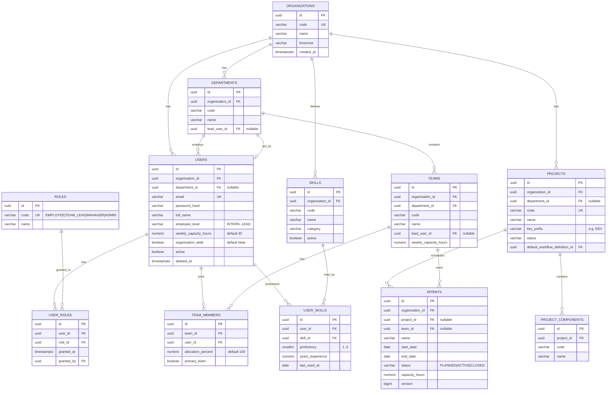
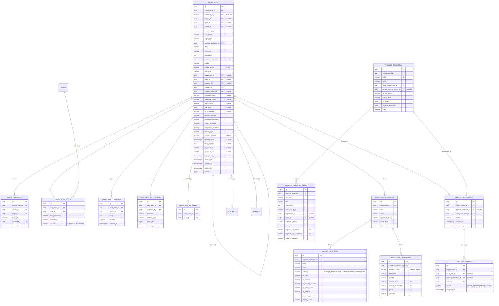
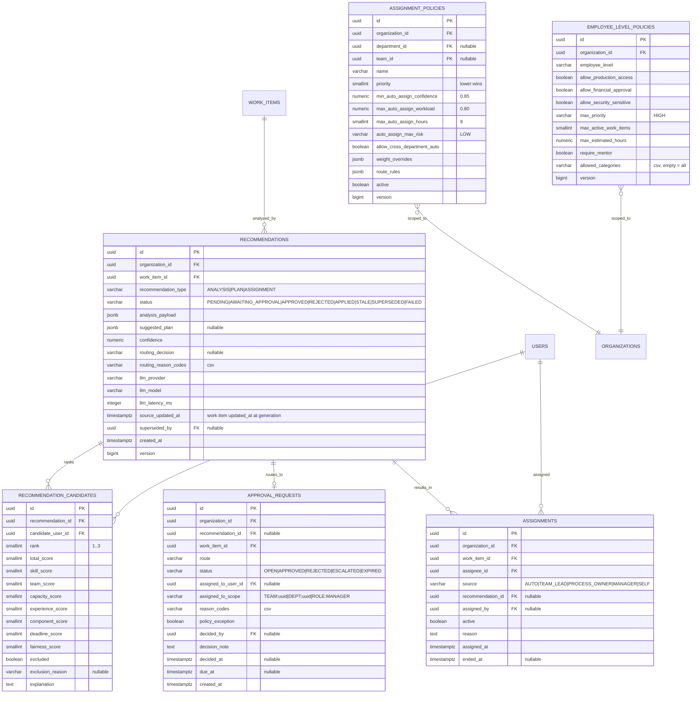
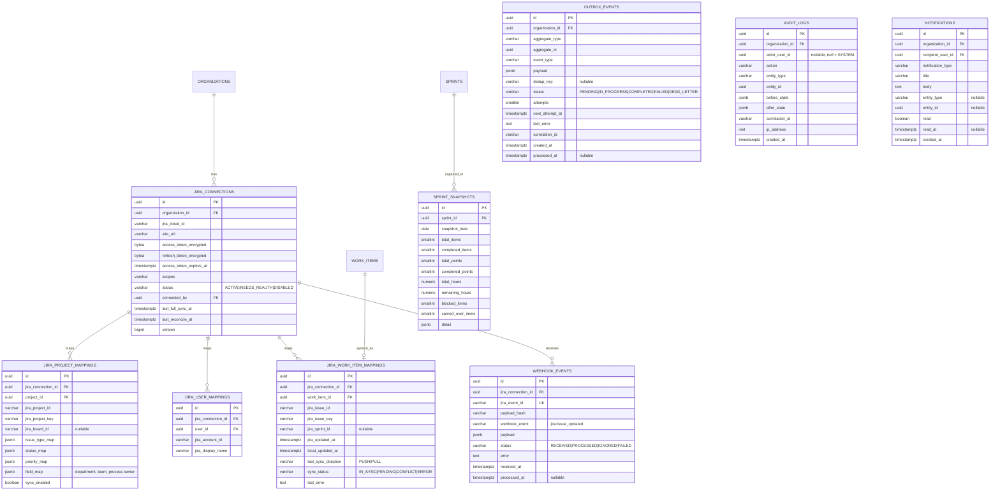

# 05 — Database & ER Diagram

PostgreSQL 16. All schema changes via Flyway. UUID v7 primary keys everywhere.

## 1. Conventions

| Convention | Rule |
|---|---|
| Primary key | `id UUID PRIMARY KEY` — v7, generated in the application so the ID is known before insert |
| Tenancy | `organization_id UUID NOT NULL REFERENCES organizations(id)` on every business table |
| Timestamps | `created_at TIMESTAMPTZ NOT NULL DEFAULT now()`, `updated_at TIMESTAMPTZ NOT NULL DEFAULT now()` (trigger-maintained) |
| Optimistic locking | `version BIGINT NOT NULL DEFAULT 0` on mutable aggregates only |
| Soft delete | `deleted_at TIMESTAMPTZ NULL` only on `work_items`, `users`, `projects`, `teams`, `skills`. Everything else is hard-deleted or immutable. |
| Enums | stored as `VARCHAR` with a `CHECK` constraint, not native PG enums — adding a value must not require an exclusive lock |
| JSON | `JSONB` for AI payloads, before/after audit snapshots and event payloads |
| Naming | `snake_case`, plural tables, `fk_`/`ix_`/`uq_`/`ck_` prefixes on constraints |
| Money/effort | `NUMERIC(8,2)` for hours; never floats |
| Text search | `pg_trgm` extension for duplicate detection on `summary` |

## 2. ER diagram — identity, organization, projects



## 3. ER diagram — work items and workflow



## 4. ER diagram — AI, policy, assignment



## 5. ER diagram — Jira, outbox, audit



## 6. Table inventory

All 37 tables required by the brief (rows 1–37), plus five additions marked ✚.

| # | Table | Purpose | Version col | Soft delete |
|---|---|---|---|---|
| 1 | `organizations` | tenant root | — | — |
| 2 | `users` | people | ✔ | ✔ |
| 3 | `roles` | system role lookup | — | — |
| 4 | `user_roles` | role grants | — | — |
| 5 | `departments` | org structure | — | — |
| 6 | `teams` | org structure | — | ✔ |
| 7 | `team_members` | membership + allocation | — | — |
| 8 | `skills` | canonical vocabulary | — | ✔ |
| 9 | `user_skills` | proficiency | — | — |
| 10 | `projects` | delivery containers | ✔ | ✔ |
| 11 | `sprints` | iterations | ✔ | — |
| 12 | `work_items` | **the core table** | ✔ | ✔ |
| 13 | `work_item_links` | typed relationships | — | — |
| 14 | `work_item_skills` | required skills | — | — |
| 15 | `work_item_comments` | discussion | — | — |
| 16 | `work_item_attachments` | files | — | — |
| 17 | `workflow_definitions` | profiles | — | — |
| 18 | `workflow_states` | states + flags | — | — |
| 19 | `workflow_transitions` | edges + guards | — | — |
| 20 | `process_definitions` | running process instances | — | — |
| 21 | `process_templates` | reusable processes | ✔ | — |
| 22 | `process_template_tasks` | template steps | — | — |
| 23 | `process_owners` | per-resource ownership | — | — |
| 24 | `recommendations` | AI output + routing | ✔ | — |
| 25 | `recommendation_candidates` | ranked candidates + score parts | — | — |
| 26 | `assignment_policies` | routing thresholds and weights | ✔ | — |
| 27 | `employee_level_policies` | level restrictions | ✔ | — |
| 28 | `approval_requests` | review/approval queue | — | — |
| 29 | `jira_connections` | OAuth + tokens | ✔ | — |
| 30 | `jira_user_mappings` | local user ↔ Jira account | — | — |
| 31 | `jira_project_mappings` | project + field/status/priority maps | — | — |
| 32 | `jira_work_item_mappings` | issue linkage + sync state | — | — |
| 33 | `sprint_snapshots` | daily burndown source | — | — |
| 34 | `outbox_events` | transactional outbox | — | — |
| 35 | `webhook_events` | inbound dedup + replay | — | — |
| 36 | `audit_logs` | append-only trail | — | — |
| 37 | `notifications` | in-app inbox | — | — |
| 38 ✚ | `work_item_watchers` | WATCHER relationship | — | — |
| 39 ✚ | `project_components` | component experience scoring | — | — |
| 40 ✚ | `refresh_tokens` | rotating refresh token store (hashed) | — | — |
| 41 ✚ | `assignments` | assignment history, distinct from current assignee | — | — |
| 42 ✚ | `skill_aliases` | AI skill-code normalization | — | — |

Additions 38–42 are load-bearing: watchers are required by the My Work "Watching" filter; components by the 10% component-experience score; refresh tokens by rotation; assignments by reassignment history and fairness scoring; aliases by AI skill resolution.

## 7. Indexes

Driven by the actual dashboard queries, not guessed.

```sql
-- Work items: the hot table
CREATE INDEX ix_wi_org_status        ON work_items (organization_id, status) WHERE deleted_at IS NULL;
CREATE INDEX ix_wi_assignee_active   ON work_items (assignee_id, status)     WHERE deleted_at IS NULL;
CREATE INDEX ix_wi_team_status       ON work_items (team_id, status)         WHERE deleted_at IS NULL;
CREATE INDEX ix_wi_department_status ON work_items (department_id, status)   WHERE deleted_at IS NULL;
CREATE INDEX ix_wi_sprint            ON work_items (sprint_id)               WHERE sprint_id IS NOT NULL;
CREATE INDEX ix_wi_parent            ON work_items (parent_id)               WHERE parent_id IS NOT NULL;
CREATE INDEX ix_wi_project_type      ON work_items (project_id, work_item_type);
CREATE INDEX ix_wi_reporter          ON work_items (reporter_id);
CREATE INDEX ix_wi_process_owner     ON work_items (process_owner_id)        WHERE process_owner_id IS NOT NULL;
CREATE INDEX ix_wi_due_open          ON work_items (due_date)                WHERE due_date IS NOT NULL;
CREATE INDEX ix_wi_jira_key          ON work_items (jira_issue_key)          WHERE jira_issue_key IS NOT NULL;
CREATE INDEX ix_wi_blocked           ON work_items (organization_id, blocked_since) WHERE blocked_since IS NOT NULL;
CREATE INDEX ix_wi_summary_trgm      ON work_items USING gin (summary gin_trgm_ops);

-- Links: traversed in both directions
CREATE INDEX ix_wil_source ON work_item_links (source_id, link_type);
CREATE INDEX ix_wil_target ON work_item_links (target_id, link_type);

-- Recommendations and approvals
CREATE INDEX ix_rec_work_item ON recommendations (work_item_id, created_at DESC);
CREATE INDEX ix_rec_status    ON recommendations (organization_id, status);
CREATE INDEX ix_ar_open_scope ON approval_requests (organization_id, status, route)
    WHERE status = 'OPEN';
CREATE INDEX ix_ar_assignee   ON approval_requests (assigned_to_user_id) WHERE status = 'OPEN';

-- Outbox: the relay's claim query
CREATE INDEX ix_outbox_claim ON outbox_events (status, next_attempt_at)
    WHERE status IN ('PENDING', 'FAILED');

-- Workload
CREATE INDEX ix_assign_active ON assignments (assignee_id) WHERE active;
CREATE INDEX ix_us_skill      ON user_skills (skill_id, proficiency DESC);
CREATE INDEX ix_wis_item      ON work_item_skills (work_item_id);

-- Audit and notifications
CREATE INDEX ix_audit_entity  ON audit_logs (entity_type, entity_id, created_at DESC);
CREATE INDEX ix_audit_corr    ON audit_logs (correlation_id);
CREATE INDEX ix_notif_unread  ON notifications (recipient_user_id, read, created_at DESC);
```

## 8. Constraints worth calling out

```sql
-- Reference keys are unique per organization, not globally
ALTER TABLE work_items ADD CONSTRAINT uq_wi_reference
    UNIQUE (organization_id, reference_key);

-- A link may not be duplicated or self-referential
ALTER TABLE work_item_links ADD CONSTRAINT uq_wil
    UNIQUE (source_id, link_type, target_id);
ALTER TABLE work_item_links ADD CONSTRAINT ck_wil_not_self
    CHECK (source_id <> target_id);

-- One active assignment per work item
CREATE UNIQUE INDEX uq_assignment_active
    ON assignments (work_item_id) WHERE active;

-- Webhook idempotency
ALTER TABLE webhook_events ADD CONSTRAINT uq_webhook_event
    UNIQUE (jira_event_id);

-- Outbox idempotency for effects that must not repeat
CREATE UNIQUE INDEX uq_outbox_dedup
    ON outbox_events (aggregate_id, event_type, dedup_key)
    WHERE dedup_key IS NOT NULL;

-- One Jira issue maps to one work item and vice versa
ALTER TABLE jira_work_item_mappings ADD CONSTRAINT uq_jwim_issue
    UNIQUE (jira_connection_id, jira_issue_id);
ALTER TABLE jira_work_item_mappings ADD CONSTRAINT uq_jwim_item
    UNIQUE (work_item_id);

-- Enum guards (sample)
ALTER TABLE work_items ADD CONSTRAINT ck_wi_type CHECK (work_item_type IN (
    'REQUEST','INCIDENT','EPIC','FEATURE','STORY','BUG','TASK',
    'TECHNICAL_DEBT','RESEARCH','TEST','DOCUMENTATION','SUBTASK'));
ALTER TABLE work_items ADD CONSTRAINT ck_wi_priority
    CHECK (priority IN ('LOW','MEDIUM','HIGH','CRITICAL'));
ALTER TABLE work_items ADD CONSTRAINT ck_wi_points
    CHECK (story_points IS NULL OR story_points IN (1,2,3,5,8,13,21));
ALTER TABLE work_items ADD CONSTRAINT ck_wi_hours
    CHECK (estimated_hours IS NULL OR (estimated_hours > 0 AND estimated_hours <= 200));
ALTER TABLE work_items ADD CONSTRAINT ck_wi_confidence
    CHECK (ai_confidence IS NULL OR (ai_confidence >= 0 AND ai_confidence <= 1));

-- A SUBTASK must have a parent; a REQUEST/INCIDENT/EPIC must not
ALTER TABLE work_items ADD CONSTRAINT ck_wi_parent_rules CHECK (
    (work_item_type = 'SUBTASK' AND parent_id IS NOT NULL) OR
    (work_item_type IN ('REQUEST','INCIDENT','EPIC') AND parent_id IS NULL) OR
    (work_item_type NOT IN ('SUBTASK','REQUEST','INCIDENT','EPIC'))
);

-- Score components are percentages
ALTER TABLE recommendation_candidates ADD CONSTRAINT ck_rc_scores CHECK (
    total_score BETWEEN 0 AND 100 AND skill_score BETWEEN 0 AND 100 AND
    team_score BETWEEN 0 AND 100 AND capacity_score BETWEEN 0 AND 100 AND
    experience_score BETWEEN 0 AND 100 AND component_score BETWEEN 0 AND 100 AND
    deadline_score BETWEEN 0 AND 100 AND fairness_score BETWEEN 0 AND 100
);
```

**Cycle prevention** is not expressible as a CHECK constraint. `WorkItemLinkService` runs a recursive CTE before inserting `PARENT_OF`, `BLOCKS` or `DEPENDS_ON`:

```sql
WITH RECURSIVE reachable AS (
    SELECT target_id FROM work_item_links
     WHERE source_id = :newTarget AND link_type = :type
    UNION
    SELECT l.target_id FROM work_item_links l
      JOIN reachable r ON l.source_id = r.target_id
     WHERE l.link_type = :type
)
SELECT EXISTS (SELECT 1 FROM reachable WHERE target_id = :newSource);
```

## 9. Flyway migration plan

| Version | File | Contents |
|---|---|---|
| V1 | `V1__extensions_and_organizations.sql` | `pgcrypto`, `pg_trgm`, `organizations`, `updated_at` trigger function |
| V2 | `V2__identity.sql` | `users`, `roles`, `user_roles`, `refresh_tokens` |
| V3 | `V3__organization_structure.sql` | `departments`, `teams`, `team_members` |
| V4 | `V4__skills.sql` | `skills`, `skill_aliases`, `user_skills` |
| V5 | `V5__projects_sprints.sql` | `projects`, `project_components`, `sprints` |
| V6 | `V6__workflow.sql` | `workflow_definitions`, `workflow_states`, `workflow_transitions` |
| V7 | `V7__work_items.sql` | `work_items` + all indexes and check constraints |
| V8 | `V8__work_item_details.sql` | `work_item_links`, `_skills`, `_comments`, `_attachments`, `_watchers` |
| V9 | `V9__process.sql` | `process_templates`, `process_template_tasks`, `process_definitions`, `process_owners` |
| V10 | `V10__ai_and_policy.sql` | `recommendations`, `recommendation_candidates`, `assignment_policies`, `employee_level_policies`, `approval_requests`, `assignments` |
| V11 | `V11__jira.sql` | `jira_connections`, `jira_user_mappings`, `jira_project_mappings`, `jira_work_item_mappings`, `webhook_events` |
| V12 | `V12__outbox_audit_notifications.sql` | `outbox_events`, `audit_logs`, `notifications` |
| V13 | `V13__reporting.sql` | `sprint_snapshots`, reporting views |
| R__ | `R__seed_workflow_definitions.sql` | repeatable: the six profiles, states, transitions |
| R__ | `R__seed_reference_data.sql` | repeatable: roles, skill vocabulary, default policies |
| — | `db/demo/V900__demo_data.sql` | demo profile only: org, 4 depts, 6 teams, 20 users, projects, sprint, templates |

Demo data lives in a separate migration location activated only by the `demo` Spring profile, so a clean environment never inherits fake people.

## 10. Reporting views

Read models for dashboards, so report queries never join eight tables at request time.

| View | Feeds |
|---|---|
| `v_user_workload` | assigned hours, remaining hours, active points, review load, workload ratio per user |
| `v_team_capacity` | team capacity vs committed hours for the active sprint |
| `v_department_capacity` | rollup of the above |
| `v_ticket_metrics` | volume, closed, open, SLA breach, avg resolution, reopened, converted-to-dev |
| `v_development_metrics` | completed stories/bugs/points, carry-over, cycle time, review time, test time, blocked duration |
| `v_ai_metrics` | recommendations generated, auto-assign rate, edit rates by role, low-confidence rate, acceptance by field |
| `v_planned_vs_unplanned` | origin-type rollup per sprint and department |

`v_ai_metrics` deliberately aggregates by *role*, *team* and *department* — never by individual assignee — so no per-person performance number can be derived from it.
