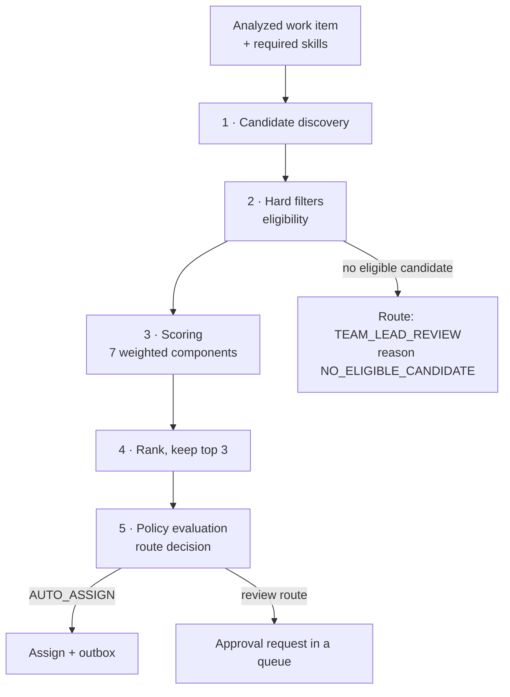
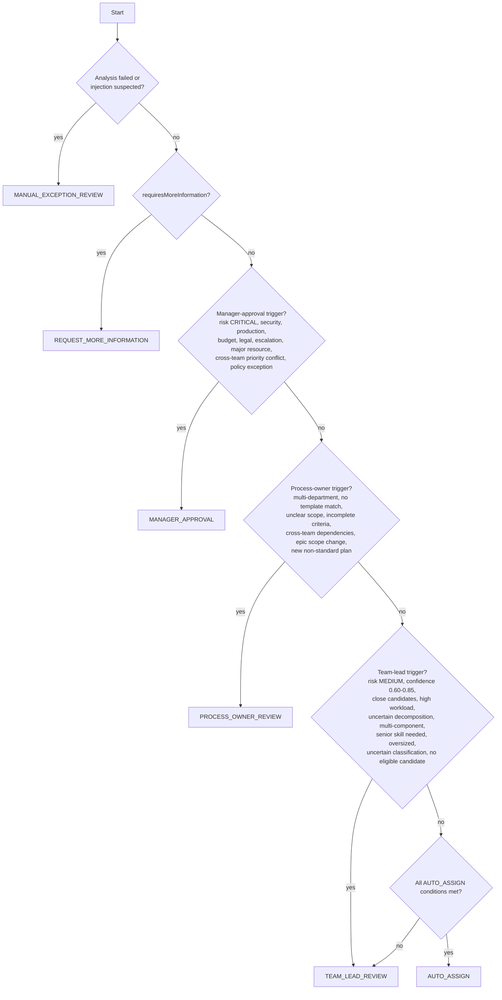

# 08 — Policy Engine, Assignment Scoring & Workload

Everything in this document is deterministic Java, running on stored data, fully unit-testable, with no LLM in the loop.

## 1. Pipeline



## 2. Candidate discovery

The initial pool, in order of preference. The first non-empty tier wins.

| Tier | Pool |
|---|---|
| 1 | Active members of the recommended team |
| 2 | Active members of all teams in the recommended department |
| 3 | Anyone in the organization holding **all mandatory skills** — only when `allow_cross_department_auto` is false, this tier can never produce `AUTO_ASSIGN` |

Discovery is a single query joining `team_members`, `users`, `user_skills` and `v_user_workload`, so a pool of a few hundred people costs one round trip.

## 3. Hard filters (eligibility)

Applied before scoring. A failure is recorded in `recommendation_candidates` with `excluded = true` and a reason code, so the UI can show *why* an obvious person was skipped — one of the most useful explainability features in the product.

| Filter | Exclusion reason |
|---|---|
| User inactive or soft-deleted | `INACTIVE_USER` |
| Missing a `mandatory` skill at `min_proficiency` | `MISSING_MANDATORY_SKILL` |
| `employee_level_policies` violation (see §7) | `LEVEL_RESTRICTION_*` |
| Workload ratio > 1.2 | `SEVERELY_OVERLOADED` |
| On leave for the whole remaining window to the due date | `UNAVAILABLE` |
| Is the reporter, and the item requires independent review | `SELF_ASSIGNMENT_CONFLICT` |
| Already assigned the sibling this item `DEPENDS_ON`, and both are due in the same window | `DEPENDENCY_CONFLICT` (soft — a penalty, not exclusion, when the pool is thin) |

If the filters empty the pool, the item is **not** left unassigned silently: it routes to `TEAM_LEAD_REVIEW` with `NO_ELIGIBLE_CANDIDATE`.

## 4. Scoring formula

Seven components, each normalized to 0–100, combined with configurable weights. Defaults from the brief:

| Component | Weight | Measures |
|---|---|---|
| `skillScore` | **30%** | coverage and depth against required skills |
| `capacityScore` | **20%** | how much room the person has |
| `teamScore` | **15%** | department / team alignment |
| `experienceScore` | **10%** | similar completed work |
| `componentScore` | **10%** | experience in the affected components / project |
| `deadlineScore` | **10%** | can they realistically finish by the due date |
| `fairnessScore` | **5%** | recent assignment distribution |

```
totalScore = round( 0.30·skill + 0.20·capacity + 0.15·team
                  + 0.10·experience + 0.10·component
                  + 0.10·deadline + 0.05·fairness )
```

Weights live in `assignment_policies.weight_overrides` (JSONB) and are resolved most-specific-first: team → department → organization → built-in defaults. A validator asserts the weights sum to 1.0 before a policy can be saved.

### 4.1 Skill score

```
For each required skill s with min_proficiency m:
    if user lacks s                       → contribution 0
    else                                  → contribution = min(100, (proficiency_u(s) / m) * 80 + recency_bonus)

recency_bonus = 20  if last_used_at within 90 days
                10  if within 365 days
                 0  otherwise

skillScore = weighted mean over required skills,
             mandatory skills weighted 2×, optional 1×
```

Rationale: exceeding the required proficiency helps, but with diminishing returns (capped at 100) — a principal engineer is not four times better than the required mid-level for a mid-level task. Recency matters because a skill last used three years ago is not the same asset.

### 4.2 Capacity score

Derived from the workload ratio `w` (§6):

```
capacityScore = 100                    if w ≤ 0.50
              = 100 − (w − 0.50)·120   if 0.50 < w ≤ 0.85     →  100 down to 58
              = 58 − (w − 0.85)·200    if 0.85 < w ≤ 1.00     →  58 down to 28
              = max(0, 28 − (w − 1.00)·140)  if w > 1.00
```

Piecewise rather than linear: the penalty accelerates past 85% because that is where predictability collapses.

### 4.3 Team score

| Situation | Score |
|---|---|
| member of the recommended team | 100 |
| different team, same department | 70 |
| different department, but holds all mandatory skills | 40 |
| different department, partial skills | 15 |

### 4.4 Experience score

```
similar = completed work items in the last 180 days sharing
          ≥ 2 required skills OR the same category code

experienceScore = min(100, 25·ln(1 + similar) · qualityFactor)
qualityFactor   = 1.0 − 0.15·(reopened_similar / max(1, similar))
```

Logarithmic so the tenth similar task adds far less than the second. `qualityFactor` uses reopen rate on *the same kind of work* — a process signal, not a performance grade, and it is never surfaced per person in any report.

### 4.5 Component score

```
componentScore = 100  if the user completed work in ≥ 2 of the affected components in the last 180 days
               =  75  if exactly 1 affected component
               =  50  if no component overlap but work in the same project
               =  20  otherwise
```

Falls back to `teamScore` when the item names no components (typical for service work), so it never becomes dead weight in the formula.

### 4.6 Deadline score

```
availableHours = remaining working hours before due_date, given the user's
                 capacity, existing commitments and known leave
slack          = (availableHours − estimatedHours) / max(1, estimatedHours)

deadlineScore  = 100                  if slack ≥ 1.0
               = 60 + 40·slack        if 0 ≤ slack < 1.0
               = max(0, 60 + 60·slack) if slack < 0
```

No due date → 75 (neutral-positive), so undated work does not distort ranking.

### 4.7 Fairness score

```
assignedLast14d = count of items assigned to the user in the last 14 days
teamMedian      = median over the eligible pool

fairnessScore = 100                                   if assignedLast14d ≤ teamMedian
              = max(0, 100 − 25·(assignedLast14d − teamMedian))
```

This is the anti-hotspot term: it stops the highest-skilled person absorbing everything, which is the classic failure mode of naive skill matching. At 5% weight it breaks ties without overriding competence.

### 4.8 Explicitly forbidden inputs

Gender, age, race, ethnicity, religion, disability, political affiliation, family status.

These are not "excluded from the formula" — **they are absent from the schema**. There is no column to accidentally join. Enforcement in CI:

```java
@Test
void candidateFeatureVectorContainsOnlyPermittedComponents() {
    assertThat(CandidateScore.componentNames()).containsExactlyInAnyOrder(
        "skill", "team", "capacity", "experience", "component", "deadline", "fairness");
}

@Test
void userTableHasNoProtectedCharacteristicColumns() {
    var forbidden = Set.of("gender","sex","age","birth_date","race","ethnicity",
                           "religion","disability","political","marital_status",
                           "family_status","nationality");
    assertThat(columnNamesOf("users")).doesNotContainAnyElementsOf(forbidden);
}
```

The second test is the meaningful one: it fails the build if anyone ever adds such a column, whatever their intent.

### 4.9 Output

Top three candidates, every component stored separately:

```json
{
  "candidateUserId": "018f...",
  "rank": 1,
  "totalScore": 91,
  "skillScore": 95, "teamScore": 100, "capacityScore": 82,
  "experienceScore": 90, "componentScore": 88,
  "deadlineScore": 90, "fairnessScore": 80,
  "explanation": "Strong skill, component and capacity match."
}
```

Explanations are generated from a template, not by an LLM — the top two and bottom one contributing components are named. Deterministic, instant, and always consistent with the numbers beside it.

## 5. Policy engine



Evaluated **top-down, first match wins**. Ordering is the safety property: the most restrictive route is tested first, so no combination of conditions can produce a laxer outcome than the strictest applicable trigger.

### 5.1 `AUTO_ASSIGN` — all must hold

| # | Condition | Configurable |
|---|---|---|
| 1 | `riskLevel == LOW` | `auto_assign_max_risk` |
| 2 | `confidence ≥ 0.85` | `min_auto_assign_confidence` |
| 3 | top candidate's `workloadRatio ≤ 0.80` | `max_auto_assign_workload` |
| 4 | exactly one department **and** one team involved | `allow_cross_department_auto` |
| 5 | `securityImpact == false` | fixed |
| 6 | `productionImpact == false` | fixed |
| 7 | `budgetImpact == false` | fixed |
| 8 | `complianceImpact == false` | fixed |
| 9 | no active policy exception on the item | fixed |
| 10 | candidate satisfies all level restrictions | fixed |
| 11 | `estimatedHours ≤ 8` and the item is a leaf | `max_auto_assign_hours` |
| 12 | no unresolved `DEPENDS_ON` link | fixed |
| 13 | `topScore − secondScore ≥ 5` (unambiguous winner) | `min_score_gap` |
| 14 | `topScore ≥ 60` | `min_auto_assign_score` |

Conditions 13 and 14 are additions beyond the brief. Without 13, auto-assign fires on coin-flips; without 14, it fires on the best of a bad pool. Both are the difference between a demo that impresses and one that produces an obviously wrong assignment on stage.

### 5.2 `TEAM_LEAD_REVIEW` triggers

`riskLevel == MEDIUM` · `0.60 ≤ confidence < 0.85` · `topScore − secondScore < 5` · top candidate `workloadRatio > 0.80` · `requiresDecomposition` with confidence < 0.75 · `affectedComponents.size() > 2` · a required skill needs `SENIOR`+ · `estimatedHours > max_auto_assign_hours` · department or team confidence < 0.80 · `NO_ELIGIBLE_CANDIDATE`.

### 5.3 `PROCESS_OWNER_REVIEW` triggers

`departments.size() > 1` · `teams.size() > 1` across the generated plan · `matchedProcessTemplate == null` on `PROCESS_WORK` · `businessObjective` missing or scope confidence < 0.6 · acceptance criteria incomplete on a `STORY`/`FEATURE` · plan contains cross-team `DEPENDS_ON` edges · epic/feature scope changed after approval · a new non-standard plan was generated.

### 5.4 `MANAGER_APPROVAL` triggers

`riskLevel == CRITICAL` · `securityImpact` · `productionImpact` · `budgetImpact` · `complianceImpact` · `estimatedTotalHours > 80` (major resource) · cross-team priority conflict detected · an active policy exception · Team Lead escalation · Process Owner escalation.

### 5.5 Route resolution to an actual person

| Route | Approver resolution |
|---|---|
| `TEAM_LEAD_REVIEW` | `teams.lead_user_id` of the target team; falls back to `departments.lead_user_id` |
| `PROCESS_OWNER_REVIEW` | the item's `process_owner_id`; else the nearest ancestor's; else the template's default; else the dominant department's lead |
| `MANAGER_APPROVAL` | any `MANAGER` scoped to the department; org-wide managers see all |
| `REQUEST_MORE_INFORMATION` | the REQUESTER, else the reporter |
| `MANUAL_EXCEPTION_REVIEW` | the team lead, and an `ADMIN` notification |

Approval requests are addressed to a **scope** (`TEAM:uuid`, `DEPT:uuid`, `ROLE:MANAGER`) rather than a single person wherever possible, so work does not stall behind one individual's absence.

### 5.6 Output

```java
public record RoutingDecision(
    ApprovalRoute route,
    List<String> reasonCodes,      // e.g. ["CONFIDENCE_BELOW_AUTO_THRESHOLD","CANDIDATE_SCORES_CLOSE"]
    String explanation,            // template-generated from the reason codes
    ApproverScope approverScope,
    Duration suggestedSla
) {}
```

Reason codes are a closed enum. Every route decision is fully explainable from stored data and replayable against a different policy version — which is what makes the "why did this need approval?" question answerable six months later.

## 6. Workload calculation

**Never task count.** The brief is explicit, and it is right: five 1-hour tasks and five 40-hour tasks are not the same load.

```
workloadRatio = openEstimatedHours / remainingCapacityHours
```

### Numerator

```
openEstimatedHours =
      Σ remaining_hours of items in an is_active_work state
    + Σ estimated_hours of items in a TODO-category state assigned to the user
    + reviewLoad          (0.5 h per item awaiting this user's review)
    + supportDutyHours    (from the on-call/support roster, if configured)
    − blockedHours        (items blocked > 24 h count at 30%, not 0% —
                            they still occupy attention and will return)
```

Fallback estimates when `estimated_hours` is missing, configurable per organization:

| Work item type | Fallback |
|---|---|
| `SUBTASK` | 2 h |
| `TASK` | 4 h |
| `BUG` | 6 h |
| `TEST`, `DOCUMENTATION` | 3 h |
| `STORY` | 8 h, or `story_points × hoursPerPoint` (default 2.5) when points exist |
| `RESEARCH` | 8 h |
| `TECHNICAL_DEBT` | 6 h |

### Denominator

```
remainingCapacityHours =
      weeklyCapacityHours × (allocationPercent / 100)
    × (remainingWorkingDays in the sprint / 10)          [2-week sprint]
    − leaveHours in that window
    − meetingOverhead   (default 15% of capacity)
```

Outside an active sprint, a rolling two-week window is used.

### Bands

| Ratio | Band | UI |
|---|---|---|
| < 0.50 | `UNDERUTILIZED` | grey |
| 0.50 – 0.85 | `HEALTHY` | green |
| 0.85 – 1.00 | `HIGH` | amber |
| > 1.00 | `OVERLOADED` | red |

Surfaced per person to their Team Lead (a capacity signal they must act on), and only in aggregate above that. `v_user_workload` materializes the numerator and denominator so scoring is one join rather than N queries.

## 7. Employee level policies

Stored in `employee_level_policies`, one row per level, editable by Admin.

### Default INTERN restrictions

| Restriction | Default | Exclusion reason code |
|---|---|---|
| Production access | denied | `LEVEL_RESTRICTION_PRODUCTION_ACCESS` |
| Financial / budget approval work | denied | `LEVEL_RESTRICTION_FINANCIAL` |
| Security-sensitive configuration | denied | `LEVEL_RESTRICTION_SECURITY` |
| Max priority | `HIGH` — no `CRITICAL` | `LEVEL_RESTRICTION_PRIORITY` |
| Max active work items | 3 | `LEVEL_RESTRICTION_MAX_ACTIVE` |
| Max estimated hours per item | 8 | `LEVEL_RESTRICTION_MAX_HOURS` |
| Mentor required | true — a `SENIOR`+ reviewer must be set | `LEVEL_RESTRICTION_MENTOR_REQUIRED` |
| Allowed categories | allowlist; empty means all | `LEVEL_RESTRICTION_CATEGORY` |

Defaults for other levels: `JUNIOR` — no production, max priority `HIGH`, max 6 active, max 16 h. `MID` — no financial approval. `SENIOR`/`LEAD` — unrestricted.

Enforced in **two** places, deliberately:

1. **Candidate filtering**, so a restricted person never appears as a recommendation.
2. **Transition guard `LEVEL_RESTRICTION`**, so a Team Lead manually assigning a restricted task is stopped too. Manual override requires `MANAGER_APPROVAL` with a recorded justification.

This is a deterministic backend rule. It is never expressed as a prompt instruction — an LLM told "do not assign interns to production work" will comply most of the time, and "most of the time" is not an authorization model.

## 8. Policy resolution order

Most specific wins:

```
team policy → department policy → organization policy → built-in defaults
```

Within a tier, lower `priority` wins. Every policy change writes an audit row with before/after, and `assignment_policies` is versioned so a historical routing decision can be replayed against the policy that was actually in force.

## 9. Test plan (Phases 5 and 6)

| Test | Asserts |
|---|---|
| `SkillScoreTest` | exact-match, over-qualified, under-qualified, missing-mandatory, recency bonus boundaries |
| `CapacityScorePiecewiseTest` | all four segments and the boundary values 0.50 / 0.85 / 1.00 |
| `FairnessScoreTest` | the busiest eligible person is demoted below an equally skilled quieter one |
| `WeightSumValidationTest` | a policy whose weights do not sum to 1.0 is rejected on save |
| `NoProtectedCharacteristicsTest` | the feature vector and the `users` table contain no protected attribute |
| `WorkloadUsesHoursNotCountTest` | 5×1 h and 5×40 h produce different ratios |
| `WorkloadFallbackEstimatesTest` | missing estimates resolve by type, and story points convert |
| `BlockedWorkCountsPartiallyTest` | long-blocked items contribute 30% |
| `PolicyOrderingTest` | a critical + low-confidence item routes to `MANAGER_APPROVAL`, never `TEAM_LEAD_REVIEW` |
| `AutoAssignAllConditionsTest` | 14 tests, each flipping exactly one condition and asserting the route degrades |
| `AutoAssignRequiresScoreGapTest` | a 91 vs 89 tie routes to `TEAM_LEAD_REVIEW` |
| `InternRestrictionTest` | interns are excluded from production, financial, critical and oversized items |
| `InternManualAssignBlockedTest` | a Team Lead's manual override of a level restriction requires manager approval |
| `NoEligibleCandidateTest` | an empty pool routes to `TEAM_LEAD_REVIEW`, never leaves the item silently unassigned |
| `PolicyResolutionOrderTest` | team overrides department overrides organization |
| `RoutingIsReplayableTest` | the same inputs and policy version reproduce the identical decision and reason codes |
