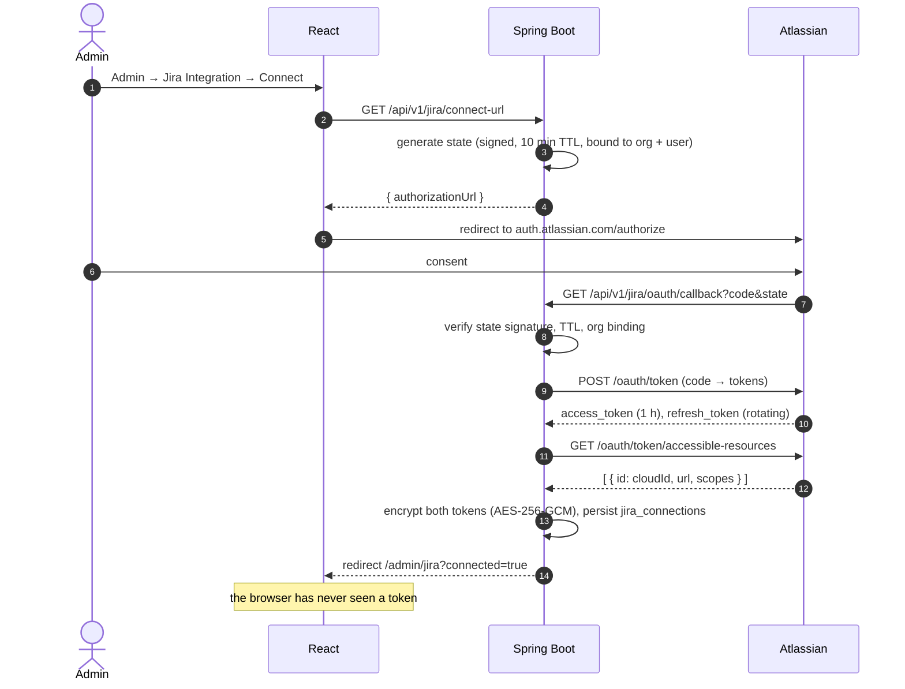
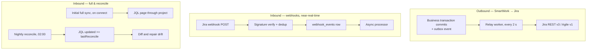
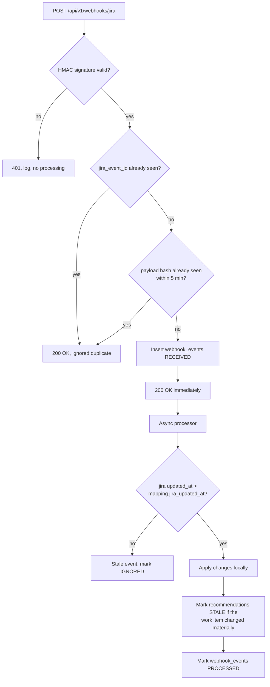
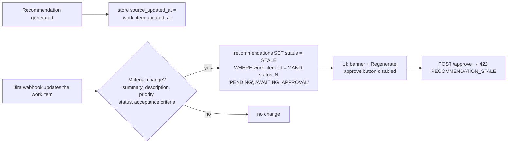
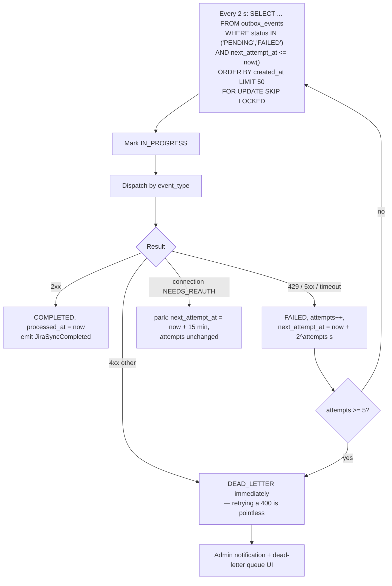

# 09 — Jira Cloud Integration

Real OAuth 2.0 3LO integration, designed so the platform is fully functional when Jira is absent.

## 1. Responsibility split

| Concern | Owner |
|---|---|
| Issue content (summary, description, status, priority, assignee) | **Jira** is the system of record |
| Analysis, recommendations, candidate scores, policy routes, approvals, audit | **SmartWork AI** is the system of record |
| Sprint membership | Jira, mirrored locally |
| Work item hierarchy and typed links | SmartWork AI, projected into Jira where Jira supports it |

Conflict rule: on a reconciliation collision, **Jira wins for content fields, SmartWork wins for its own decision state.** A conflict is recorded in `jira_work_item_mappings.sync_status = CONFLICT` and surfaced on the admin sync page rather than resolved silently.

## 2. OAuth 2.0 3LO



### Scopes

```
read:jira-work        write:jira-work        read:jira-user
manage:jira-webhook   offline_access
```

`offline_access` is what yields the refresh token. `manage:jira-project` is deliberately **not** requested — the platform never creates or reconfigures Jira projects.

### Token handling

| Aspect | Design |
|---|---|
| Storage | `BYTEA`, AES-256-GCM, key from `JIRA_TOKEN_ENCRYPTION_KEY` (env, 32 bytes base64), per-row random IV stored with the ciphertext |
| Refresh | Proactive at T−5 min; serialized per connection with a Postgres advisory lock so concurrent workers cannot race and invalidate each other's rotating refresh token |
| Rotation | Atlassian rotates refresh tokens; the new one replaces the old atomically in the same transaction as the access token |
| Failure | Refresh failure → `status = NEEDS_REAUTH`, admin notification, outbox events **park** (not dead-letter) so nothing is lost |
| Exposure | No DTO contains a token field. `JiraConnectionResponse` is a record without one, and a serialization test asserts the JSON of a populated connection contains neither token |
| Logging | A Logback converter masks anything matching a token pattern |

## 3. Mapping configuration

Per project, in `jira_project_mappings`, editable by Admin.

### Issue type

| Local | Jira default | Note |
|---|---|---|
| `EPIC` | Epic | |
| `FEATURE` | Epic or a custom type | falls back to Story with a label when the site has no Feature type |
| `STORY` | Story | |
| `BUG` | Bug | |
| `TASK` | Task | |
| `SUBTASK` | Sub-task | requires a parent issue |
| `TECHNICAL_DEBT` | Task | + label `tech-debt` |
| `RESEARCH` | Task | + label `spike` |
| `TEST` | Task | + label `test` |
| `DOCUMENTATION` | Task | + label `documentation` |
| `REQUEST` | Task | in the service project, or a JSM request type when available |
| `INCIDENT` | Bug | + label `incident`, priority floor Highest |

Unmapped types fall back to `Task` plus a label — the integration degrades rather than failing.

### Status → transition

The map is `localState → jiraTransitionName`, not `localState → jiraStatus`, because the Jira API applies transitions, not statuses. At sync time the platform reads `GET /issue/{key}/transitions` and matches by name, then by target status name, then gives up and records a conflict rather than forcing anything.

| Local | Jira transition (default) |
|---|---|
| `TODO`, `READY`, `ASSIGNED` | To Do |
| `IN_PROGRESS`, `ANALYSIS`, `INVESTIGATING` | In Progress |
| `CODE_REVIEW` | In Review |
| `TESTING`, `QA` | In Review (fallback) or Testing |
| `BLOCKED` | In Progress + label `blocked` (most Jira workflows have no blocked status) |
| `DONE`, `RESOLVED`, `VERIFIED`, `COMPLETED` | Done |
| `CLOSED` | Done |
| `CANCELLED` | Done + resolution `Won't Do` |

### Priority

| Local | Jira |
|---|---|
| `CRITICAL` | Highest |
| `HIGH` | High |
| `MEDIUM` | Medium |
| `LOW` | Low |

### Field mapping

| Local concept | Jira target | Fallback when unavailable |
|---|---|---|
| Department | Component, or a custom field | label `dept-<code>` |
| Team | custom field, or Component | label `team-<code>` |
| Process Owner | custom field (user picker) | add as a watcher |
| Affected components | Components | labels |
| Project | Jira project | required — no fallback |
| Sprint | Sprint field via the Agile API | omitted if no board is mapped |
| Reference key | custom field or the description footer | description footer |
| AI confidence | *never synced* | — |
| Candidate scores | *never synced* | — |

The last two rows matter: internal scoring data does not leave the platform. Score components are visible to a Team Lead in the review UI; they are not published into a system where the whole company can read them.

### Description format

Jira Cloud requires **ADF** (Atlassian Document Format) on the v3 API. `AdfConverter` renders the local Markdown-ish description into ADF nodes (paragraphs, bullet lists, code blocks, links) and appends a footer:

```
─────────────────────────
Managed by SmartWork AI · TCK-102 · https://smartwork.local/work-items/018f...
```

Inbound, ADF is flattened back to plain text with structure preserved. Round-trip fidelity is not guaranteed for exotic nodes (panels, media); those are preserved verbatim in the ADF stored alongside the flattened text so a local edit never destroys them.

## 4. Synchronization strategies

Three, complementary.



### 4.1 Initial full synchronization

On first connecting a project: page through `POST /rest/api/3/search/jql` with `project = X ORDER BY created ASC`, 100 issues per page. Each issue creates a local work item with `origin_type = JIRA_IMPORTED`, a `jira_work_item_mappings` row, and an `WorkItemAnalysisRequested` event so imported work gets analyzed too. Parent/child relationships are resolved in a second pass once all issues exist. Progress is reported via `GET /jira/sync-status`.

### 4.2 Webhook incremental sync

Registered via `manage:jira-webhook` for `jira:issue_created`, `jira:issue_updated`, `jira:issue_deleted`, `comment_created`, `sprint_started`, `sprint_closed`.



The endpoint returns 200 in single-digit milliseconds — it only inserts a row. Atlassian retries on non-2xx, so slow processing inside the handler would cause duplicate storms.

**Loop prevention:** every outbound write records `expectedJiraUpdatedAt`. An inbound webhook whose change matches a write this platform just made within a 30-second window is marked `IGNORED` with reason `SELF_ORIGINATED`. Without this, a status push generates a webhook that generates a local update that generates a push.

### 4.3 Nightly reconciliation

02:00 local time, per connection. `JQL: project IN (mapped) AND updated >= -26h`. For each issue, compare Jira's `updated` against `jira_work_item_mappings.jira_updated_at`:

| Case | Action |
|---|---|
| Jira newer, local unchanged | pull |
| Local newer, Jira unchanged | push |
| Both changed | `sync_status = CONFLICT`; content fields take Jira, decision state stays local; admin is notified |
| Exists in Jira, missing locally | import |
| Exists locally with a mapping, deleted in Jira | mark mapping `ERROR`, keep local item, notify |

Reconciliation is what makes the integration honest: webhooks are lossy, and a system that only trusts webhooks drifts silently.

## 5. Stale recommendation detection



Approving stale advice is worse than having none: the analysis described a different piece of work. The check is enforced server-side in the approval transaction, not only in the UI.

## 6. Outbox worker



`FOR UPDATE SKIP LOCKED` means multiple backend instances can drain the same table safely with no coordination. Backoff: 2, 4, 8, 16, 32 seconds, then dead letter. Dead-lettered events are inspectable and replayable from `/admin/outbox/dead-letter`.

### Event → Jira operation

| Event | Jira calls |
|---|---|
| `WorkItemCreated` (dev family, project mapped) | `POST /issue`, store id/key |
| `AssignmentAutoApproved` / `AssignmentApproved` | `PUT /issue/{key}/assignee` |
| `WorkItemStarted` / `WorkItemCompleted` / any transition | `GET /issue/{key}/transitions` then `POST /issue/{key}/transitions` |
| `WorkItemBlocked` | `POST /issue/{key}/comment` + add label `blocked` |
| `WorkItemPlanGenerated` | `POST /issue` per child + `POST /issueLink` for typed links |
| `SprintChanged` | `POST /rest/agile/1.0/sprint/{id}/issue` |
| `JiraSyncRequested` (generic) | field update via `PUT /issue/{key}` |

Every call sets `X-Atlassian-Token` where required and carries the correlation ID in a custom header for cross-system tracing.

## 7. Rate limits and resilience

| Concern | Handling |
|---|---|
| Atlassian 429 | honour `Retry-After` exactly; the worker sleeps rather than burning attempts |
| Cost budget | batch reads use JQL with explicit `fields` lists — never `*all` |
| Bulk operations | `POST /issue/bulk` for plan generation (up to 50 issues per call) |
| Timeouts | connect 5 s, read 30 s |
| Circuit breaker | Resilience4j: open after 10 consecutive failures, half-open after 60 s; while open the relay parks rather than hammering |
| Idempotency | `outbox_events.dedup_key` prevents a retried "create issue" from producing two issues; before creating, the worker re-reads the mapping row |

## 8. Working without Jira

The MVP must demo with or without a connected site.

| Situation | Behaviour |
|---|---|
| No connection configured | `jira_issue_key` stays null; outbox events are created and remain `PENDING`; the UI hides Jira columns and shows a subtle "Jira not connected" chip on the admin page |
| Connection revoked mid-demo | events park; nothing 500s; local workflow continues |
| Demo mode (`SMARTWORK_JIRA_MODE=mock`) | `MockJiraClient` returns synthetic keys (`DEMO-101`) and transitions, so the full sync UI is exercisable offline |

No code path outside the `jira` module imports a Jira type. Removing the module would leave a system that still runs end to end.

## 9. Test plan (Phase 8)

| Test | Asserts |
|---|---|
| `JiraOAuthCallbackTest` | state signature, TTL, org binding; a forged state is rejected |
| `TokenEncryptionRoundTripTest` | tokens are unreadable at rest and recover exactly |
| `TokenNeverSerializedTest` | no DTO's JSON contains a token, asserted over the whole `jira` package |
| `TokenRefreshConcurrencyTest` | two workers refreshing simultaneously produce one valid rotation, not two |
| `WebhookDeduplicationTest` | the same `jira_event_id` twice processes once |
| `WebhookOutOfOrderTest` | an older `updated` timestamp does not overwrite a newer local state |
| `WebhookSelfOriginatedTest` | a webhook caused by our own push is ignored — no loop |
| `WebhookSignatureTest` | an invalid HMAC returns 401 and does not persist |
| `StaleRecommendationTest` | a material Jira update marks pending recommendations `STALE` and blocks approval |
| `OutboxRetryBackoffTest` | 2/4/8/16/32 s progression, then `DEAD_LETTER` |
| `OutboxDeadLetterOn4xxTest` | a 400 dead-letters immediately without five retries |
| `OutboxSkipLockedTest` | two workers never claim the same event |
| `OutboxIdempotencyTest` | a retried create does not produce a duplicate issue |
| `AdfConversionTest` | markdown → ADF → text round-trips, and unknown nodes survive |
| `TransitionNameResolutionTest` | mapping falls back name → target-status → conflict |
| `ReconciliationConflictTest` | both-changed produces `CONFLICT` with Jira content winning and local decision state intact |
| `NoJiraConnectionTest` | the full onboarding scenario completes end to end with no connection configured |
