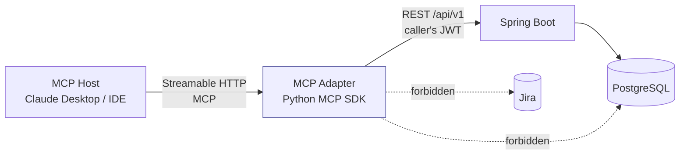

# 10 — MCP Adapter

A separate service exposing SmartWork AI to agentic hosts (Claude Desktop, IDEs) over the Model Context Protocol.

## 1. Position and constraints



| Constraint | Guarantee |
|---|---|
| Never connects to PostgreSQL | the container has no `DATABASE_URL` and no DB driver in its dependency tree |
| Never sees Jira tokens | it calls `/api/v1/jira/*` endpoints, which never return tokens |
| Never bypasses approval or authorization | every tool is a thin wrapper over an existing REST endpoint, called with the **end user's own JWT** |
| Adds no privileges | if the user cannot do it in the web UI, the MCP tool returns the same 403/404 |
| Cannot force an assignment | there is no "assign" tool; `create_assignment_recommendation` produces a recommendation that goes through the identical policy engine |

The adapter is a **translator, not a gateway**. It holds no business logic. Deleting it removes an interface and nothing else.

## 2. Authentication

MCP host → adapter uses the MCP session with a bearer token supplied at configuration time; the adapter forwards it verbatim as `Authorization: Bearer …` to Spring Boot. The adapter has no credentials of its own, so it cannot act on behalf of anyone who has not authenticated.

Every call carries `X-Correlation-Id` and `X-Client: mcp-adapter`, so the audit log distinguishes agent-initiated actions from UI-initiated ones — a Team Lead reviewing an audit trail can see that a recommendation was requested by an agent.

## 3. Resources

Read-only, URI-addressed context.

| URI | Backing endpoint | Returns |
|---|---|---|
| `work-item://{workItemId}` | `GET /work-items/{id}` | full detail, links, skills, status, permissions |
| `ticket://{ticketId}` | `GET /work-items/{id}` | same, constrained to `REQUEST`/`INCIDENT`; 404 otherwise |
| `project://{projectId}` | `GET /admin/projects/{id}` + item counts | project, components, active sprint, counts by status |
| `team://{teamId}/workload` | `GET /team-lead/workload?teamId=` | capacity, per-member ratios and bands, skill coverage |
| `department://{departmentId}/workload` | `GET /manager/capacity?departmentId=` | department rollup |
| `employee://{employeeId}/skills` | `GET /admin/users/{id}/skills` | skills with proficiency and recency |
| `sprint://{sprintId}/metrics` | `GET /sprints/{id}/metrics` | points, hours, carry-over, blocked, burndown series |

Resource content is JSON with a short human-readable preamble, so a model gets both structure and orientation. A resource the caller cannot see returns an MCP error mirroring the backend's 404 — the adapter never explains *why* something is invisible.

## 4. Tools

| Tool | Backing call | Mutating |
|---|---|---|
| `get_work_item` | `GET /work-items/{id}` | no |
| `analyze_work_item` | `POST /work-items/{id}/analyze` then poll `GET .../analysis` | no (analysis only) |
| `list_child_work_items` | `GET /work-items/{id}/children` | no |
| `list_work_item_links` | `GET /work-items/{id}/links` | no |
| `get_team_workload` | `GET /team-lead/workload` | no |
| `get_department_workload` | `GET /manager/capacity` | no |
| `list_assignment_candidates` | `GET /recommendations/{id}` or a dry-run ranking endpoint | no |
| `create_assignment_recommendation` | `POST /work-items/{id}/analyze` + candidate ranking | **yes** — creates a recommendation, never an assignment |
| `get_sprint_metrics` | `GET /sprints/{id}/metrics` | no |
| `generate_sprint_summary` | `GET /sprints/{id}/metrics` + `/reports/development` | no |
| `investigate_blocked_work` | `GET /team-lead/blocked` + link traversal | no |

### The one mutating tool

`create_assignment_recommendation` is the only tool with a side effect, and its contract is deliberately narrow:

```python
@mcp.tool()
async def create_assignment_recommendation(work_item_id: str) -> dict:
    """Generate an assignment recommendation for a work item.

    This creates a RECOMMENDATION only. It never assigns anyone. The routing
    decision (auto-assign vs. review) is made by the backend policy engine and
    cannot be influenced by this call. Items requiring review will appear in the
    relevant queue for a human to approve.
    """
```

It cannot pass a preferred assignee, cannot request `AUTO_ASSIGN`, and cannot suppress an approval. If the policy engine routes the result to `MANAGER_APPROVAL`, that is what the tool returns, and the agent's only remaining option is to tell the user a manager must approve it.

`investigate_blocked_work` is the tool that best demonstrates the value: it walks `DEPENDS_ON` and `BLOCKS` chains from every blocked item in a team, identifies the root blockers, and returns them with owner and age — a query that takes a Team Lead several minutes of clicking in Jira.

## 5. Prompts

Reusable prompt templates surfaced to the host as slash-style commands.

| Prompt | Arguments | Purpose |
|---|---|---|
| `analyze-ticket` | `ticket_id` | walk a ticket's classification, missing information and risk |
| `analyze-development-work` | `work_item_id` | assess scope, acceptance criteria and technical risk |
| `explain-assignment` | `recommendation_id` | narrate the score components and route reason codes in plain language |
| `summarize-sprint` | `sprint_id` | progress, risks, carry-over, blocked work |
| `investigate-blocked-work` | `team_id` | root-cause the team's blocked chain |
| `propose-task-decomposition` | `work_item_id` | draft a decomposition for a human to review |

`explain-assignment` is worth highlighting: the underlying score components are already deterministic and stored, so the model is translating numbers into prose rather than inventing a rationale. The explanation cannot contradict the decision.

`propose-task-decomposition` produces a **proposal in the conversation**, not persisted work items. Creating them still requires the normal `/generate-plan` path with its policy routing.

## 6. Transport and deployment

- **Streamable HTTP** on `:9000/mcp`. Chosen over stdio so the adapter runs as an ordinary Compose service, is reachable by remote hosts, and can be scaled or removed independently.
- Stateless between calls; MCP session state is held by the SDK per connection.
- Config: `SMARTWORK_API_BASE_URL`, `MCP_HTTP_PORT`, `REQUEST_TIMEOUT_SECONDS`, `LOG_LEVEL`. Note the absence of `DATABASE_URL`, `JIRA_*` and `ANTHROPIC_API_KEY` — the adapter needs none of them.
- Health at `/health`; the service is optional in Compose (`profiles: [mcp]`) so the core demo does not depend on it.

## 7. Error translation

| Backend | MCP result |
|---|---|
| 401 | error: "Authentication failed. Reconnect SmartWork AI in your MCP settings." |
| 403 | error: "You do not have permission to do this in SmartWork AI." — never explains the rule, to avoid leaking the authorization model |
| 404 | error: "Not found or not visible to you." — same text for both, matching the backend's deliberate ambiguity |
| 409 | error: "The item changed while you were working on it. Fetch it again." |
| 422 `RECOMMENDATION_STALE` | error: "This recommendation is stale because the item changed in Jira. Regenerate it first." |
| 429 | error with `retry_after` |
| 5xx / timeout | error: "SmartWork AI is unavailable." — the adapter never fabricates a fallback answer |

The adapter never invents data on failure. An agent that cannot reach the backend must say so, not guess.

## 8. Test plan (Phase 9)

| Test | Asserts |
|---|---|
| `test_no_database_dependency` | the container's import graph contains no DB driver; `DATABASE_URL` is unset |
| `test_no_jira_credentials` | no `JIRA_*` variable is read anywhere in the adapter |
| `test_tools_forward_caller_jwt` | every tool call carries the caller's token, not a service token |
| `test_employee_cannot_assign_via_mcp` | an EMPLOYEE calling `create_assignment_recommendation` gets a recommendation, never an assignment |
| `test_mcp_route_matches_rest_route` | the same work item routed via MCP and via REST produces the identical `RoutingDecision` |
| `test_cannot_force_auto_assign` | no tool argument can influence the route; the schema has no such field |
| `test_403_leaks_nothing` | forbidden responses contain no entity data and no rule description |
| `test_resource_visibility` | a resource URI for an invisible item returns not-found, identical to a nonexistent one |
| `test_backend_down_reports_failure` | with the backend stopped, every tool errors clearly and none returns synthetic data |
