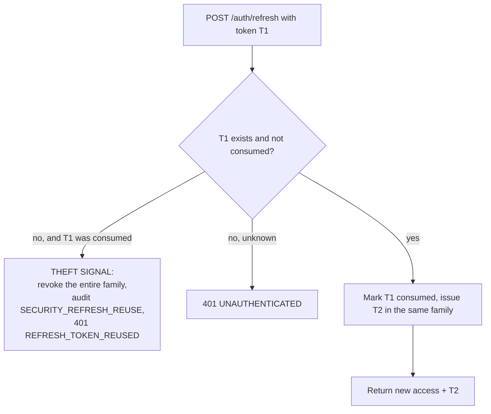

# 11 — Security

## 1. Threat model

The threats that actually apply to this system, and where each is answered.

| # | Threat | Mitigation | Where |
|---|---|---|---|
| T1 | Employee reads another department's confidential work | query-level visibility predicates; 404 not 403 | §4 |
| T2 | Employee assigns work to a colleague to offload it | no assign capability at all; reassignment is a request | [03](03-roles-and-authorization.md) |
| T3 | Jira token leaks to the browser or logs | tokens encrypted at rest, absent from every DTO, masked in logs | §6 |
| T4 | Prompt injection in a ticket description makes the AI escalate privileges | structural: the AI has no authority; plus sanitization | §7 |
| T5 | Cross-organization data leak | tenancy filter + tests | §4 |
| T6 | Stolen refresh token used for persistent access | rotation with reuse detection; family revocation | §3 |
| T7 | Approval bypass via a crafted API call | policy evaluated server-side; route ≤ actor authority; transitions validated | §5 |
| T8 | Forged Jira webhook injects false state | HMAC verification + dedup + timestamp ordering | §8 |
| T9 | MCP agent used to escalate privileges | adapter forwards the user's own JWT and adds nothing | [10](10-mcp-server.md) |
| T10 | Intern assigned to production-impacting work | deterministic level policies at two enforcement points | [08](08-policy-and-assignment.md) |
| T11 | Bias in assignment via protected characteristics | such columns do not exist; asserted in CI | [08](08-policy-and-assignment.md) §4.8 |
| T12 | Audit tampering to hide a bad decision | append-only table, no update/delete grants | §9 |
| T13 | Credential stuffing on login | Argon2id + rate limit + lockout | §2, §10 |
| T14 | Malicious file upload | type allowlist, size cap, no execution, out-of-webroot storage | §11 |

## 2. Authentication

| Aspect | Design |
|---|---|
| Password hashing | **Argon2id**, m=64 MiB, t=3, p=1. Chosen over BCrypt for memory hardness. |
| Password policy | ≥ 12 chars, checked against a compromised-password list; no forced rotation (NIST 800-63B) |
| Access token | JWT, HS512 (single service, symmetric is appropriate), **15 min** TTL |
| Refresh token | opaque 256-bit random, stored **hashed** (SHA-256) in `refresh_tokens`, **7 day** TTL |
| Claims | `sub`, `org`, `roles`, `teams`, `dept`, `lvl`, `iat`, `exp`, `jti`. Deliberately no PII beyond the user ID. |
| Clock skew | 30 s leeway |
| Logout | revokes the token family; access tokens are short-lived rather than blacklisted |

### Refresh token rotation with reuse detection

A consumed token being presented again means either a replay or a stolen token racing the legitimate client. Both warrant killing the family. This turns silent token theft into a detectable, audited event.

## 3. Authorization

Four layers, all of which must pass — described in full in [03-roles-and-authorization.md](03-roles-and-authorization.md) §4.

1. Authentication filter → principal + `OrganizationContext` + MDC
2. `@PreAuthorize` coarse role gate
3. `WorkItemAccessEvaluator` resource + relationship check, **pushed into SQL** for list endpoints
4. Domain guards: workflow transitions, policy engine, level restrictions

Two properties worth restating because they are the ones most often lost in implementation:

- **List endpoints filter in SQL, never in memory.** Fetch-then-filter leaks existence through pagination totals.
- **Invisible ≠ forbidden.** Items the caller may not see return 404. 403 is reserved for visible items the caller may not modify.

## 4. Tenancy and scope isolation

| Boundary | Mechanism | Test |
|---|---|---|
| Organization | `organization_id` on every business table; Hibernate `@Filter` enabled per request from the JWT claim | `CrossOrganizationIsolationTest` — every endpoint, foreign org, expects empty/404 |
| Department | visibility predicate from the principal's department scope | `TeamLeadScopeTest` |
| Team | predicate from `principal.teamIds` | `TeamLeadScopeTest` |
| Confidential items | `security_sensitive = true` narrows to assignee, process owner, department manager, admin | `SensitiveItemVisibilityTest` |

The organization filter is applied at the Hibernate session level rather than in each repository method, because one forgotten `WHERE` clause is a full tenant breach. Repository-level tests assert that a raw `findAll()` on a foreign context returns nothing.

## 5. Business-logic integrity

The most valuable security property of this system is not confidentiality — it is that **decisions cannot be forged**.

| Guarantee | How |
|---|---|
| The frontend cannot set an arbitrary status | the API accepts transition *names*; the engine resolves the target state |
| Approval cannot be skipped | routing is computed server-side at approval time, not read from the request |
| A lower role cannot approve a higher route | `route ≤ actorAuthority`; a Team Lead approving a `MANAGER_APPROVAL` item gets 403 `ROUTE_NOT_PERMITTED` |
| Self-review is impossible | `NOT_SELF_REVIEW` guard, in code, not configuration |
| Review and test stages cannot be skipped | no such edge exists in the workflow graph |
| Stale advice cannot be applied | staleness checked inside the approval transaction |
| Double approval cannot occur | optimistic lock + `ALREADY_DECIDED` |
| AI cannot influence authorization | its response schema contains no authorization field ([07](07-ai-service-contract.md) §2) |

## 6. Secrets and credentials

| Secret | Storage | Notes |
|---|---|---|
| `JWT_SECRET` | env | ≥ 512 bits; a startup check refuses to boot on the default value outside `dev` |
| `JIRA_CLIENT_ID` / `JIRA_CLIENT_SECRET` | env | never logged |
| `JIRA_TOKEN_ENCRYPTION_KEY` | env | 32 bytes base64; AES-256-GCM with a per-row IV |
| Jira access/refresh tokens | `BYTEA` encrypted in `jira_connections` | never in any DTO; serialization test enforces it |
| `ANTHROPIC_API_KEY` | env, **AI service only** | the backend never holds it |
| `SERVICE_TOKEN` | env, backend + AI service | constant-time comparison |
| DB credentials | env | |

Rules: no secret in the repository; `.env.example` contains names and empty values only; `.env` is gitignored; Docker Compose reads from the environment; a startup validator fails fast on missing or default-valued secrets in non-dev profiles.

**Log masking.** A Logback converter redacts anything matching JWT, Atlassian token, `Authorization:` header or API-key patterns. Applied to the root appender, so it also covers third-party libraries that log request headers.

## 7. Prompt injection defence

Layered, with the structural layer doing the real work.

| Layer | Defence |
|---|---|
| **Structural (primary)** | The AI service cannot assign, approve, transition or write. A fully successful injection yields a *bad suggestion*, which a policy engine and possibly a human then evaluate. This is the only defence that does not depend on pattern matching. |
| Schema constraint | Output is validated against a closed Pydantic schema with `extra="forbid"`. There is no field through which an instruction could take effect. |
| Vocabulary constraint | Departments, teams, skills and templates must come from the supplied `org_context`. Invented values fail post-validation. |
| Input sanitization | PII redaction, length clamp, delimiter fencing, known-pattern detection ([07](07-ai-service-contract.md) §5) |
| Detection and routing | `injection_suspected = true` routes the item to `MANUAL_EXCEPTION_REVIEW` and notifies an admin |
| Confidence floor | Analyses below the configured confidence never auto-assign, so a degraded analysis cannot act unsupervised |

Stated plainly: **we do not rely on the model refusing to be manipulated.** We rely on it having nothing to manipulate.

## 8. Webhook security

| Control | Detail |
|---|---|
| Signature | HMAC-SHA256 over the raw body against the registered secret, constant-time compared |
| Raw body | captured before deserialization — re-serializing changes bytes and breaks verification |
| Replay | `jira_event_id` uniqueness, plus a payload-hash window of 5 minutes |
| Ordering | applied only if `jira updated_at > mapping.jira_updated_at` |
| Rate limit | per connection, ahead of persistence |
| Failure mode | invalid signature → 401, logged, nothing persisted |
| Response time | insert and return 200 immediately; processing is async, so slowness cannot cause Atlassian retry storms |

## 9. Audit logging

Append-only. The application's DB role holds `INSERT` and `SELECT` on `audit_logs` and no `UPDATE` or `DELETE` — enforced by grants, not convention.

Audited events: work item creation · AI analysis requested/completed/failed · clarification requested · plan generated · assignment recommended · automatic assignment · recommendation edited · approval · rejection · reassignment · workflow transition · policy change · Jira sync · escalation · closure · login success/failure · refresh reuse · permission denied · Jira connect/disconnect.

Each row stores: actor (null = `SYSTEM`), action, entity type, entity ID, before state (JSONB), after state (JSONB), correlation ID, IP, timestamp.

Before/after snapshots are recorded at the **application service** layer, not via entity listeners, because a listener sees a field diff but not the *intent* — "assignee changed" is far less useful than "recommendation approved with an override".

Correlation IDs make the whole chain queryable: one ID links ticket creation → analysis → plan → each recommendation → each approval → each Jira sync.

## 10. Input validation and rate limiting

| Control | Detail |
|---|---|
| Bean Validation | on every request DTO; `@Valid` at every controller method |
| Size caps | summary 255, description 20 000, comment 10 000, attachment 25 MB |
| SQL injection | JPA parameter binding throughout; the two native reporting queries use named parameters only |
| XSS | React escapes by default; no `dangerouslySetInnerHTML`; descriptions render through a sanitizing markdown renderer with an element allowlist |
| CSRF | not applicable — bearer tokens in a header, no cookie auth |
| CORS | explicit origin allowlist per environment; no wildcard with credentials |
| Headers | HSTS, `X-Content-Type-Options: nosniff`, `X-Frame-Options: DENY`, a restrictive CSP, `Referrer-Policy: strict-origin-when-cross-origin` |
| Mass assignment | request DTOs are separate records that simply lack server-controlled fields — they cannot be set because they cannot be expressed |

Rate limits (Bucket4j; in-memory for MVP, Redis when enabled):

| Endpoint | Limit |
|---|---|
| `POST /auth/login` | 5 / min / IP + 10 / hour / account, then a 15-min lockout |
| `POST /auth/refresh` | 30 / min / user |
| `POST /work-items/*/analyze` | 10 / min / user |
| `POST /webhooks/jira` | 100 / min / connection |
| all others | 300 / min / user |

## 11. File uploads

Allowlist by MIME **and** magic bytes (`png, jpeg, gif, pdf, txt, csv, docx, xlsx, zip`). 25 MB cap. Stored outside the web root with generated names; the original filename is metadata only. Served through an authorized endpoint with `Content-Disposition: attachment` and `Content-Type: application/octet-stream` — never inline, never from a static path. Executables and SVG are rejected (SVG can carry script).

## 12. Service-to-service

| Link | Auth |
|---|---|
| Backend → AI service | `X-Service-Token`, constant-time compared; the AI service rejects everything else |
| MCP adapter → backend | the end user's JWT, forwarded verbatim; the adapter has no identity of its own |
| Backend → Jira | OAuth bearer, per organization connection |

In production Compose, only the frontend and backend ports are published; the AI service and MCP adapter are reachable only on the internal network.

## 13. Dependency and supply chain

- OWASP Dependency-Check (Java) and `pip-audit` (Python) in CI, failing on High/Critical
- `npm audit --audit-level=high` for the frontend
- Dependabot on all three ecosystems
- Docker images pinned by digest; non-root user in every container; multi-stage builds so no build toolchain ships in the runtime image
- Trivy scan of built images in CI

## 14. Known MVP limitations

Stated honestly rather than left for a reviewer to find:

| Limitation | Post-MVP fix |
|---|---|
| Symmetric JWT signing (HS512) | RS256 with key rotation once more than one service verifies tokens |
| No MFA | TOTP enrolment |
| No field-level encryption beyond Jira tokens | pgcrypto on sensitive descriptions |
| Rate limiting is per-instance without Redis | Redis-backed buckets |
| No automated key rotation | KMS-managed keys |
| Attachments on local disk | object storage with signed URLs |
| Audit log has no cryptographic chaining | hash-chained rows for tamper evidence |
| No penetration test | scheduled before any production use |

The MVP is a hackathon deliverable. It should not be exposed to real employee data without addressing at least MFA, RS256 and object storage.
